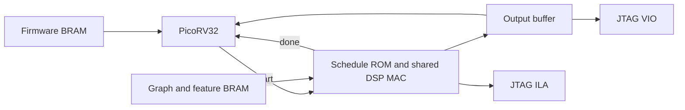

# Data stream



| Stage | Input → output | Cycles |
|---|---|---:|
| Node encode | 8 × 4 → 8 × 8 INT8 | 960 |
| Edge encode | 16 × 3 → 16 × 8 INT8 | 1,536 |
| Edge message | Edge, source and destination embeddings → 16 × 8 INT8 | 9,984 |
| Destination sum | 16 messages → 8 × 8 INT16 | 576 |
| Node update | Node embedding and sum → 8 × 8 INT8 | 3,456 |
| Decode | Updated nodes → 8 × 2 INT8 | 432 |

```text
clock           0        1        2        3        4        5
phase           FETCH    READ     EXEC     FETCH    READ     EXEC
schedule ROM    read     hold     hold     read     hold     hold
feature BRAM    hold     MAC read store    hold     MAC read store
store valid     0        0        if store 0        0        if store
```

INT8 uses two's complement with five fractional bits and range −4 to 3.96875. Feature BRAM sign-extends INT8 payloads and preserves wider destination sums. Dense layers accumulate in signed 32 bits with ten fractional bits and apply `(acc + 16) >>> 5` before saturation. Encoder, message and update stages apply ReLU. Residuals add the edge or node embedding before requantization. Destination aggregation enumerates incoming edges and sums in integer arithmetic.

The accelerator accepts start while idle and holds done until the next start. The counter measures busy cycles including stalls. When advance is low, the optimized core holds phase and disables memory accesses and commits.

ILA packs busy [57], done [56], stage [55:53], entity [52:49], store valid [48], store data [47:32], and cycle count [31:0]. The trigger selects the first committed message feature of edge 0, whose source and destination are 0 and 3 in the graph.
