<p align="center">
  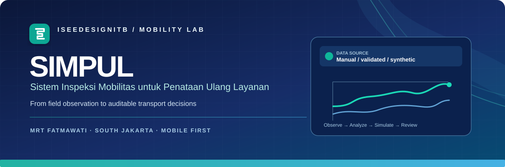
</p>

<p align="center">
  <strong>Understand vehicle stopping at MRT Fatmawati. Test curbside interventions with traceable evidence.</strong><br/>
  A modular, mobile-first mobility decision-support prototype developed from the iSeeDesignITB SIMPUL proposal.
</p>

<p align="center">
  <a href="#-get-started">Quick start</a> ·
  <a href="#-what-you-can-do">Features</a> ·
  <a href="#-architecture">Architecture</a> ·
  <a href="#-for-ai-coding-agents">AI agent guide</a> ·
  <a href="#-verification--limitations">Verification</a> ·
  <a href="#about-the-creators">Creators</a> ·
  <a href="docs/security/PENTEST_REPORT_v1.3.md">Security review</a>
</p>

<p align="center">
  
  
  
  
</p>

> [!IMPORTANT]
> **SIMPUL is a research prototype, not a validated digital twin or police enforcement system.** Its default traffic data and heuristic estimates are synthetic. The optional SUMO runner uses a synthetic network, not a calibrated MRT Fatmawati network. Public-news references and AI interpretations are *supporting context*, never confirmed violations.

---

## AIERA interface and illustrative 3D CCTV simulation (PR #1)

PR #1 adds the AIERA palette, a live schematic 3D preview, an interactive CCTV simulation page, and compact navigation with advanced pages under Settings. The A0/A1/A2 traffic simulation is synthetic and uncalibrated. External detection input is display-only and never becomes a stored field observation. Existing bilingual navigation and observation provenance remain intact.

See [PR #1 integration verification](docs/VERIFICATION_PR1.md) for observed checks, browser limitations, and the commit-attribution cleanup. No API credentials are needed for the illustrative simulation; a real detection model must be connected separately.

## Vehicle-first experience (v1.9)

<p align="center">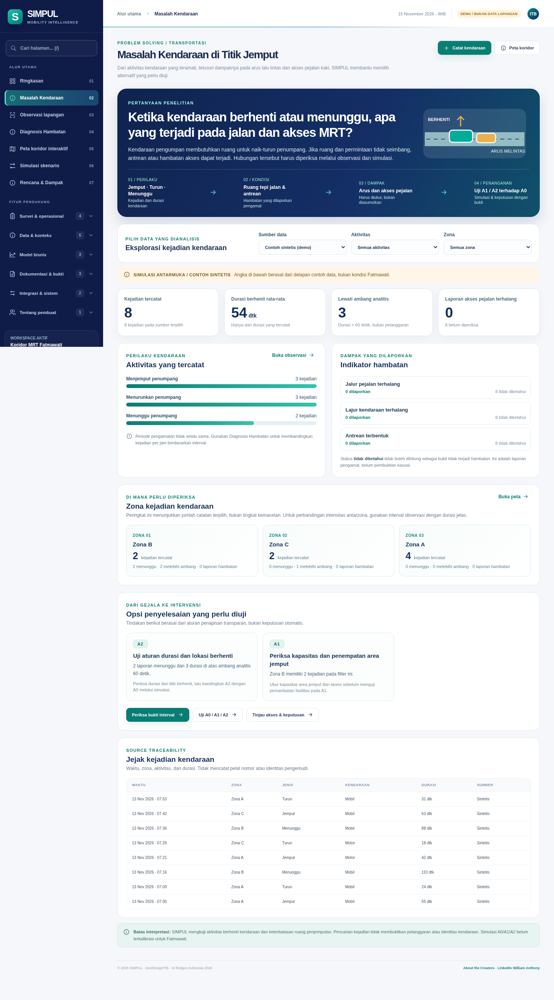</p>

SIMPUL starts with the core operational problem: vehicles picking up, dropping off, or waiting for passengers compete for curbside space. The outcome being investigated is traffic queues and obstruction of passenger/pedestrian access, not vehicle identity tracking or automatic law enforcement.

The primary app sequence is **Vehicle Problem Center → Field Observation → Diagnosis by time interval → A0/A1/A2 Simulation → Evidence-backed Evaluation**. The new **Masalah Kendaraan** page offers working source/activity/zone filters, duration and activity summaries, pedestrian/lane/queue evidence states, and review hypotheses for A1 and A2.

The example dataset is explicitly marked **synthetic**. Select manual observations only after collecting real data. Unknown obstruction fields are displayed as *unknown*. Counts of stopping events are not vehicle delay measurements or causal findings. See [Vehicle Problem Logic](docs/VEHICLE_PROBLEM_v1.9.md) and run `node tests/test_vehicle_first.mjs`.

---

## Solution-first interface (v1.8)

<p align="center">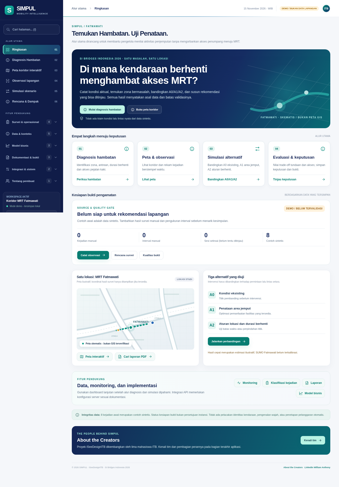</p>

The start screen now prioritizes the operational question **“Di mana kendaraan berhenti menghambat akses MRT?”** with immediate access to **Diagnosis Hambatan**, **Peta Koridor**, **Simulasi A0/A1/A2**, and **Evaluasi**. This changes only navigation and presentation, not how numerical findings are calculated.

A visible **Evidence Readiness** panel separates manually recorded events, manually measured intervals, and synthetic examples. The page deliberately does not put illustrative business revenue before the main transport problem. Other modules remain available through the collapsible sidebar.

**About the Creators** is the final navigation group and footer destination. The team list and responsibilities come from the proposal; the only linked social profile is the one supplied by the team: [William Anthony on LinkedIn](https://www.linkedin.com/in/wlmoi/). No other public profiles were inferred.

See [`docs/SOLUTION_FIRST_UI_v1.8.md`](docs/SOLUTION_FIRST_UI_v1.8.md) and `tests/test_solution_first.mjs` for navigation and credits verification.

---

## Spatial map and PDF observations (v1.7)

<div align="center">
  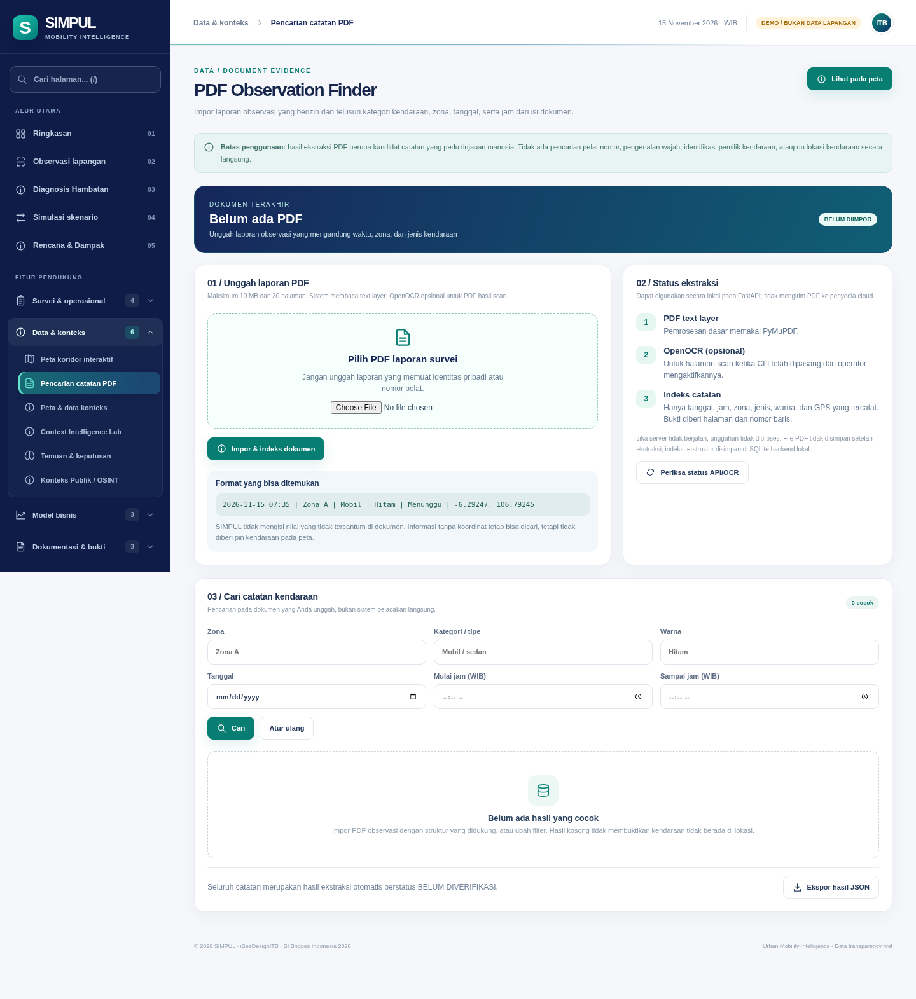
  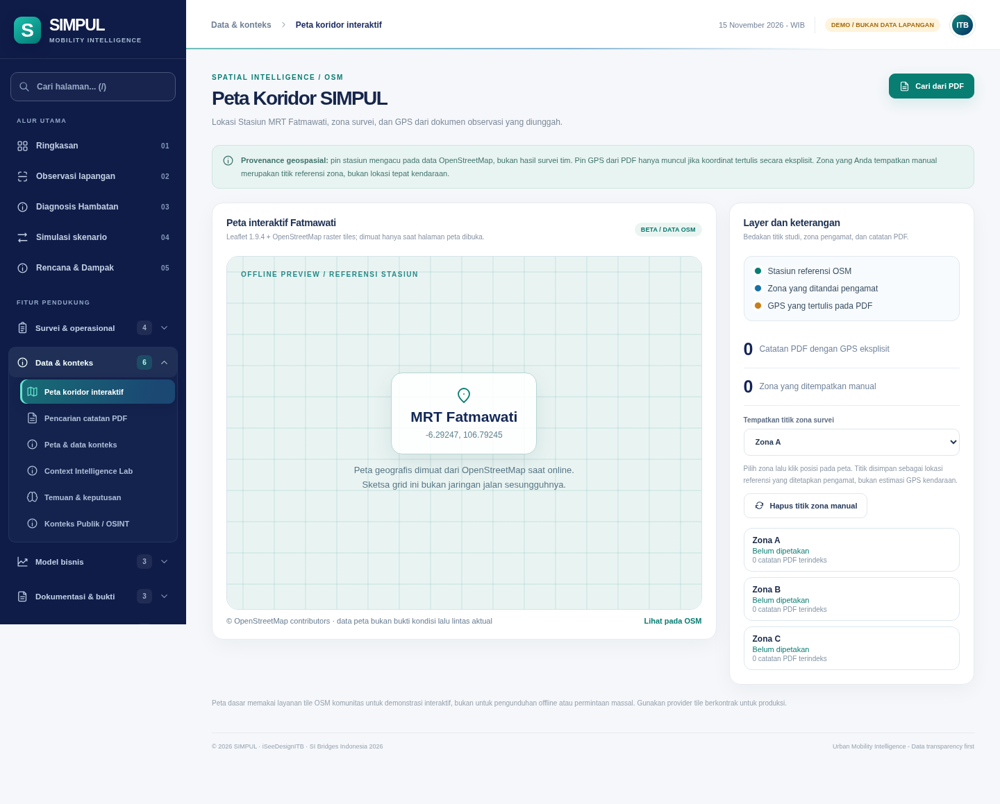
</div>

The new **Peta koridor interaktif** page provides Leaflet / OpenStreetMap visualization and makes the project location easy to inspect. **Pencarian catatan PDF** accepts an uploaded observation PDF and searches text-derived event candidates by time, zone, vehicle category, and color. Both functions preserve source and review status. The app cannot track vehicles in real time or identify their owners.

**Try the PDF workflow on your local machine:**

```powershell
python -m pip install -r server/requirements.txt
python server/app.py
```

Open `http://localhost:8888/#documents`, upload [`examples/SIMPUL_Observations_SYNTHETIC.pdf`](examples/SIMPUL_Observations_SYNTHETIC.pdf), select `Zona A`, `Mobil`, and `Hitam`, then inspect the matched 07:35 observation. Use **Peta koridor interaktif** to inspect its explicitly recorded GPS coordinate. All values in the example are synthetic.

**OpenOCR:** [`Topdu/OpenOCR`](https://github.com/Topdu/OpenOCR) is an optional local scanned-document OCR provider. It is not a vehicle detector and is not installed or enabled by default. Digital PDFs work with PyMuPDF; OCR model dependencies and weights require separate setup. See [integration design and limitations](docs/PDF_MAP_INTEGRATION_v1.7.md).

**Map providers:** Leaflet 1.9.4, OpenStreetMap standard tiles, and existing Nominatim / Overpass integrations. Do not prefetch map tiles or send personal/vehicle identity data to external map providers.

---

## ✨ Navigation & Motion Experience (v1.6)

Six directly accessible steps prioritize the problem: **Beranda → Diagnosis → Peta → Observasi → Simulasi → Evaluasi**. Other supporting pages are organized into five collapsible groups with searchable labels. On mobile, the five most decision-relevant destinations stay accessible at the bottom of the screen.

<div align="center">
  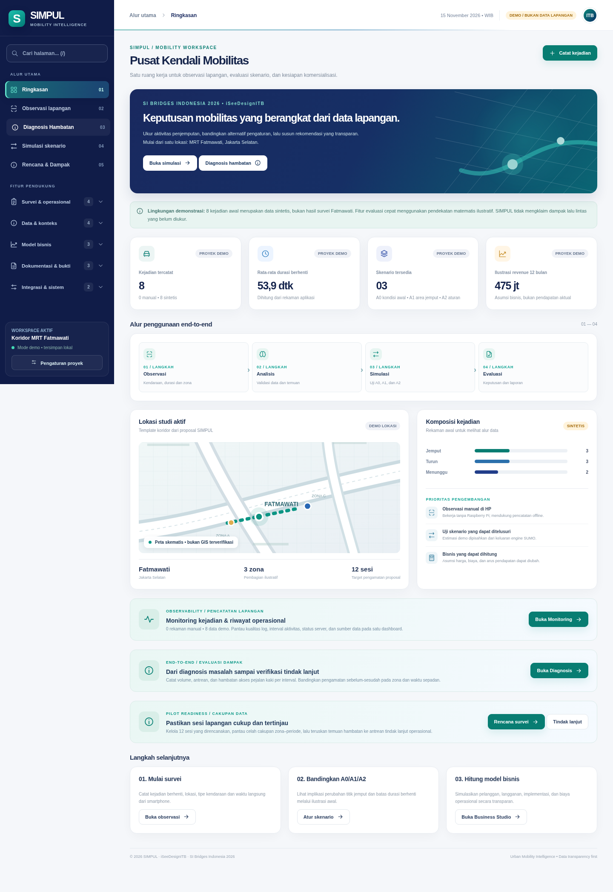
  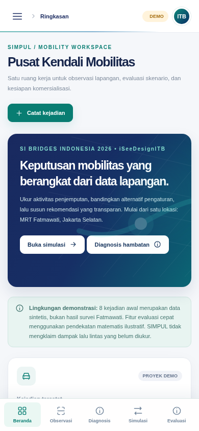
</div>

**New interaction behavior:** staged page reveal, smooth accordion expansion, animated mobile drawer, modal and toast entrances, subtle card elevation, consistent keyboard focus and `/` or `Ctrl/Cmd+K` page search. All motion respects the system's reduced-motion setting.

**Motion engine:** the default standalone application works offline with the browser's **Web Animations API**. The motion layer also supports a **self-hosted GSAP 3.15.1 runtime**, which can be installed optionally with `python tools/enable_gsap_local.py`. Actual GSAP is **not included in the default ZIP**; external animation libraries are not automatically loaded. [Interaction and motion guide](docs/MOTION_DESIGN_v1.6.md) · [Navigation IA](docs/NAVIGATION_GUIDE_v1.5.md).

**Scope protection:** this release modifies UI/UX and documentation only. Gemini processing, SUMO logic, observation evidence, classification, monitoring, and business calculations are unchanged.

---

## Overview

**SIMPUL** (*Sistem Inspeksi Mobilitas untuk Penataan Ulang Layanan*) studies how pickup, drop-off, and waiting vehicles affect traffic flow near **MRT Fatmawati, Jakarta Selatan**. It helps surveyors record conditions, analysts compare alternatives, and decision-makers examine traffic and pedestrian-access trade-offs before changing operations.

The original proposal defines four stages:

| 01 · Observe | 02 · Analyze | 03 · Simulate | 04 · Evaluate |
|:--|:--|:--|:--|
| Record type, zone, duration, time, and traffic intervals | Aggregate data; optionally interpret with Gemini | Compare **A0** baseline, **A1** pickup-area use, **A2** stopping rules | Inspect queues, delay, pedestrian access, evidence, and uncertainty |

**Primary users:** field surveyors, transportation analysts, station operators, and authorized reviewers. **Initial deployment:** local demonstration; no live police platform or automatic enforcement.

### Core field operations retained from v1.4

<table>
  <tr><td width="50%">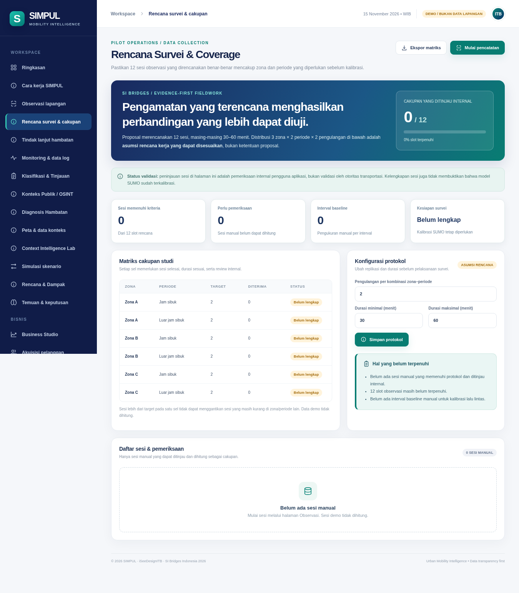</td><td width="50%">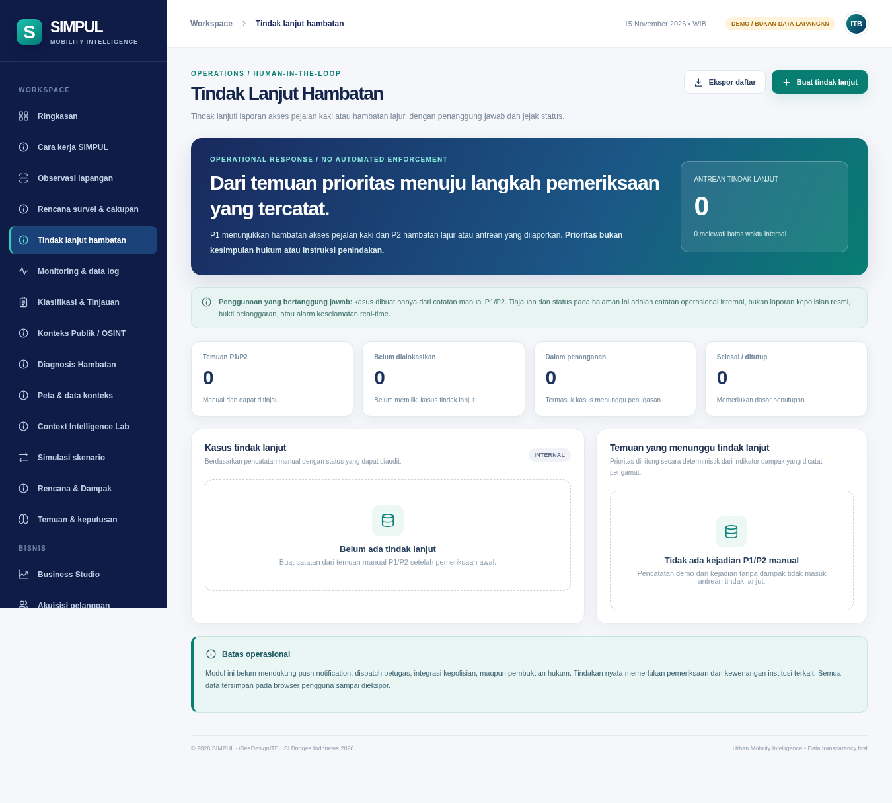</td></tr>
  <tr><td><strong>Survey Coverage Planner</strong><br/>Track planned manual sessions by zone and period, check duration, source quality, and internal review status. Based on the proposal's 12 × 30–60 min target.</td><td><strong>Operational Response Board</strong><br/>Turn manually reported P1/P2 obstructions into internal follow-ups with an owner, deadline, status, and audit history. No automated enforcement.</td></tr>
</table>

The default 3-zone × 2-period × 2-repeat schedule is a **configurable planning assumption**, not an allocation specified in the original proposal. See the [feature-gap audit](docs/FEATURE_GAP_AUDIT_v1.4.md), [release notes](docs/RELEASE_NOTES_v1.4.md), and [verification report](docs/VERIFICATION_v1.4.md).

### See the product

<p align="center">
  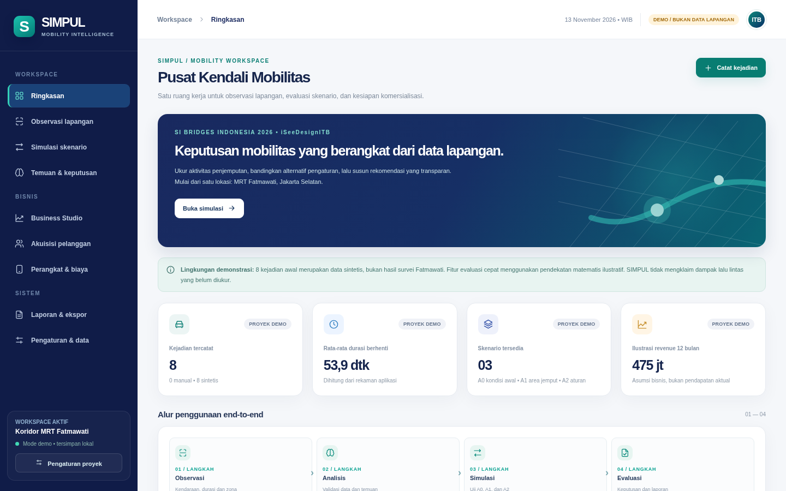
</p>
<p align="center"><em>Example dashboard from the previous prototype release. Content is illustrative and does not represent field-validated Fatmawati results.</em></p>

<details>
<summary><strong>Additional screenshots: monitoring, fieldwork, and mobile</strong></summary>
<br/>
<table>
  <tr><td width="50%">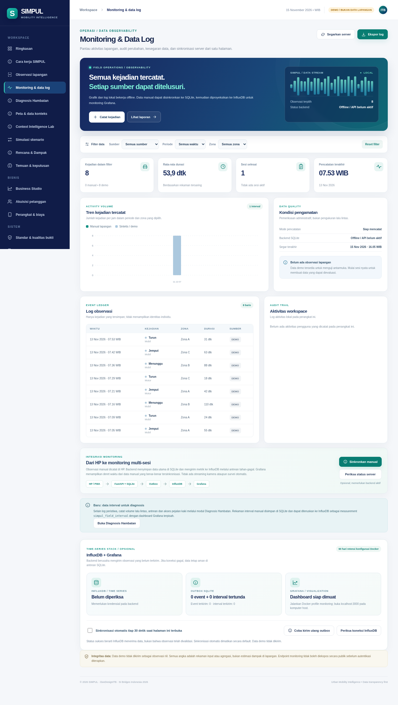</td><td width="50%">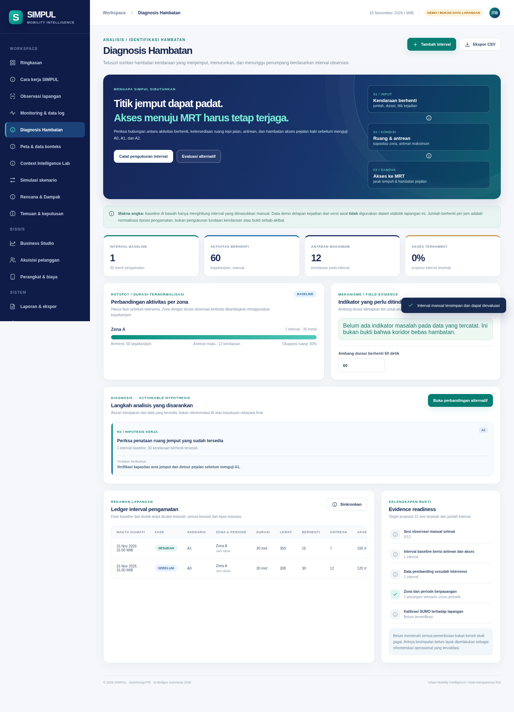</td></tr>
  <tr><td align="center"><strong>Monitoring / event logs</strong></td><td align="center"><strong>Diagnosis / evidence</strong></td></tr>
  <tr><td>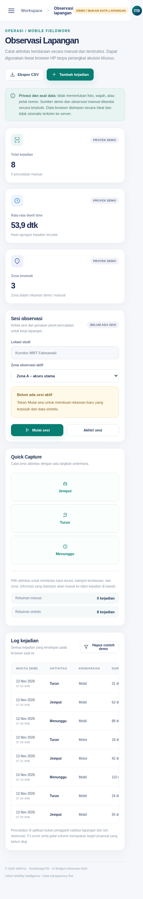</td><td>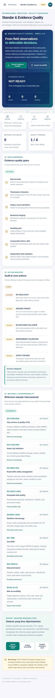</td></tr>
  <tr><td align="center"><strong>Mobile field capture</strong></td><td align="center"><strong>Evidence readiness</strong></td></tr>
</table>
</details>

---

## 🚀 Get started

Choose **one** of the following paths. No paid API key is required for the core demo.


### Security review & Strix readiness (v1.3)

> [!WARNING]
> **The autonomous Strix engine has not been run on this release.** Docker and a configured Strix runtime were unavailable in this development environment. The security changes below have been tested with local regression tests, not with Strix-generated attack proofs.

This release adds hostname filtering, optional Bearer authentication for API routes, foreign-origin write rejection, basic rate limiting, browser security headers, collision-safe observation syncing, and CSV spreadsheet-formula protection. The backend remains a **single-host research prototype**, not a multi-tenant police evidence platform.

To require an API token when running locally:

```powershell
# Generate a fresh secret locally and keep it out of Git.
$env:SIMPUL_API_TOKEN = python -c "import secrets; print(secrets.token_urlsafe(32))"
python server/app.py
```

Enter the same token under **Pengaturan & Data → Keamanan API lokal**. The browser stores it only for the current tab session. Never expose a token over plain HTTP; external hostnames require an explicitly configured allowlist and HTTPS.

To run the **actual Strix CLI later on your authorized Windows 11/WSL2 workstation**, read [the safety-gated Strix runbook](docs/security/STRIX_LOCAL_RUNBOOK.md). The runner stages only source, without the proposal PDF, databases or `.env`, and requires explicit consent before uploading source context to an LLM provider.

**Evidence:** [Local security review and residual-risk report](docs/security/PENTEST_REPORT_v1.3.md).

### Path A — Single-file demo (fastest)

1. Open **[`SIMPUL_Standalone.html`](SIMPUL_Standalone.html)** in Chrome, Edge, Safari, or another modern browser.
2. Select **Observasi lapangan**, **Diagnosis Hambatan**, or **Simulasi skenario**.
3. Explore explicitly marked demo observations and editable financial assumptions.

This mode uses browser storage. It **does not** run the Python backend, connect to Gemini/OpenOSINT, or execute real SUMO jobs. Export a backup before clearing browser data.

### Path B — Local app + FastAPI

**Requirements:** Python 3.10+, a modern browser, and optional Node.js 20+ for frontend tests.

<details open>
<summary><strong>Windows 11 / PowerShell</strong></summary>

```powershell
py -3 -m venv .venv
.\.venv\Scripts\Activate.ps1
python -m pip install -r server/requirements.txt
python server/app.py
```

Then open [http://127.0.0.1:8888](http://127.0.0.1:8888). API documentation: [http://127.0.0.1:8888/docs](http://127.0.0.1:8888/docs).

</details>

<details>
<summary><strong>macOS / Linux / WSL2</strong></summary>

```bash
python3 -m venv .venv
source .venv/bin/activate
python -m pip install -r server/requirements.txt
python server/app.py
```

Then open `http://127.0.0.1:8888`.

</details>

### Path C — Docker (optional Grafana + InfluxDB)

```bash
python tools/init_monitoring.py
# Start SIMPUL + optional observability stack
docker compose --profile monitoring up --build -d
```

| Service | Local address | Purpose |
|:--|:--|:--|
| SIMPUL | `http://localhost:8888` | App and API |
| Grafana | `http://localhost:3000` | Monitoring dashboards |
| InfluxDB | `http://localhost:8086` | Time-series observations |

`init_monitoring.py` generates **random local credentials** in `.env` and refuses to overwrite an existing `.env`. If you already have an `.env`, configure monitoring variables without replacing your existing secrets. Local Docker container-to-container interoperability was **not tested in this release environment**; see the [monitoring guide](docs/MONITORING_GRAFANA_INFLUXDB.md).

---

## What you can do

| Capability | Main screen | What it actually does |
|:--|:--|:--|
| **Field observations** | Observasi lapangan | Session/event entry, timestamps, zones and manual export |
| **Survey readiness** | Rencana survei & cakupan | Editable session coverage plan, independent internal review and gap checks |
| **Operational follow-up** | Tindak lanjut hambatan | Manual P1/P2 triage, owner assignment, due date, status history and privacy-reduced JSON export |
| **Time-series monitoring** | Monitoring & data log | Browser history, SQLite sync, optional InfluxDB outbox, Grafana configs |
| **Traffic diagnosis** | Diagnosis Hambatan | Traffic interval summaries, curbside capacity, queue and access indicators |
| **Classification** | Klasifikasi & Tinjauan | Operational P1–P4 prioritization and human review; **no legal finding** |
| **Geospatial context** | Peta & Context Intelligence | OpenStreetMap facilities, optional routing/weather/context services |
| **Public intelligence** | Konteks Publik / OSINT | Optional GDELT geolocated public-news context via **OpenOSINT** |
| **Traffic scenarios** | Simulasi skenario | A0/A1/A2 demo comparison or optional synthetic SUMO execution |
| **Evidence quality** | Standar & kualitas bukti | Source checks, provenance metadata, GeoJSON / report exports |
| **Commercial planning** | Business Studio | Editable pricing, scenario assumptions, 12-month forecasts |

SIMPUL also includes **customer discovery, equipment planning, intervention logs, and before/after comparisons**. These capabilities do not imply that external customers or traffic improvements have already been verified.

### Use case: from field event to review

For a full operational loop, open **Rencana survei & cakupan** to inspect missing sessions, start a labeled session in **Observasi lapangan**, record obstruction indicators, and review the completed session. P1/P2 manual observations can then be assigned via **Tindak lanjut hambatan**. Review labels and action statuses remain local, and must not be mistaken for independent verification or official police actions.

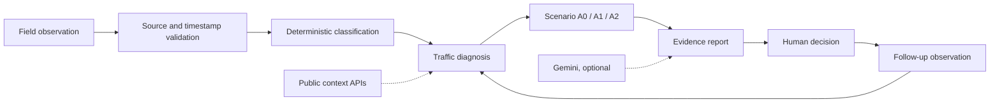

**Data hierarchy:** `manual observation` ≠ `synthetic example` ≠ `public-news mention` ≠ `simulation output`. The application must preserve these distinctions in storage, charts, and exports.

---

## 🧱 Architecture

**Design intent:** a small modular monorepo; no Kubernetes or mandatory third-party services.

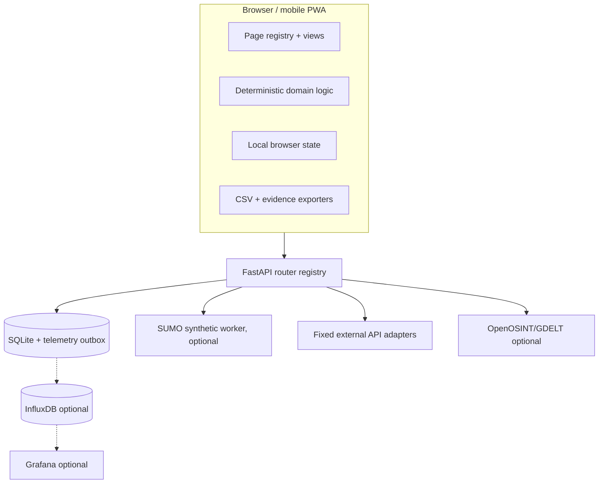

### Folder map

```text
SIMPUL/
├── js/
│   ├── app.js                   # User actions, DOM and event orchestration
│   ├── page-registry.js         # Single registry of 19 page renderers
│   ├── views/                   # One view per user-facing module
│   ├── services/                # Pure CSV/export transforms
│   ├── store.js                 # Browser state and migrations
│   └── *.js                     # Domain engines (diagnosis, finance, etc.)
├── server/
│   ├── app.py                   # FastAPI startup + static asset serving
│   ├── simulation_api.py        # SUMO job queue and HTTP endpoints
│   ├── simulation_engine.py     # Synthetic SUMO computation
│   ├── api_registry.py          # All FastAPI router registrations
│   └── *.py                     # Scoped API adapters / persistence modules
├── infrastructure/grafana/     # Provisioned monitoring dashboards
├── config/module-catalog.json  # Machine-readable agent module ownership
├── docs/
│   ├── agents/                  # Change guides for AI coding agents
│   ├── architecture/            # Boundaries, data flow and contracts
│   └── ...                      # API, methods and release verification
├── tests/                      # JS/Python regression and contract tests
├── tools/                      # Build and catalog checks
├── .github/workflows/          # JS + Python contract gates on pull requests
├── reference/                   # Original five-page proposal
├── AGENTS.md                    # Read this before agent changes
├── docker-compose.yml
└── README.md
```

**Key changes in v1.2:** The frontend page registry, export transformations, and backend router registration are now separately maintained; the single-file build discovers ES-module imports automatically. See the [architecture guide](docs/architecture/OVERVIEW.md) and [module catalog](config/module-catalog.json).

---

## 🤖 For AI coding agents

SIMPUL includes a **task routing system** for Codex, Claude Code, Cursor, and other coding agents. Start with [**AGENTS.md**](AGENTS.md), then select the smallest relevant module rather than scanning the entire repository.

| You want to change… | Open first | Verify with… |
|:--|:--|:--|
| A page, navigation, or mobile interface | [`js/AGENTS.md`](js/AGENTS.md) | `node tests/test_module_boundaries.mjs` |
| Traffic classification or review rules | [`docs/agents/TASK_PLAYBOOKS.md`](docs/agents/TASK_PLAYBOOKS.md) | `node tests/test_classification.mjs` + API tests |
| API or external provider | [`server/AGENTS.md`](server/AGENTS.md) | relevant `pytest` contract tests |
| InfluxDB or Grafana | [`infrastructure/AGENTS.md`](infrastructure/AGENTS.md) | `python tests/test_timeseries.py` |
| A data schema or migration | [`docs/architecture/DATA_CONTRACTS.md`](docs/architecture/DATA_CONTRACTS.md) | state migration + API tests |
| Standalone build | [`tools/build_standalone.py`](tools/build_standalone.py) | `npm run build:standalone` |

Automated CI runs the same JS/Python contract gates on pull requests; see [`.github/workflows/quality.yml`](.github/workflows/quality.yml). CI does **not** validate live provider integrations, SUMO or field measurements.

**Agent workflow:** inspect the current module → state the change and invariants → implement → test the affected boundary → regenerate standalone → record actual verification. Follow [task playbooks](docs/agents/TASK_PLAYBOOKS.md) and the [module ownership catalog](config/module-catalog.json).

```bash
npm run verify                  # JS tests + catalog + regenerated standalone syntax
python -m pytest -q tests/test_api_registry.py tests/test_build_standalone.py
```

The module catalog is validated automatically; adding a new page or API requires updating the corresponding registry and tests. No empty folder structure or speculative service is needed.

---

## APIs, configuration & observability

API documentation is generated by FastAPI at `/docs`. Major endpoint groups:

| Area | Interface | What to know |
|:--|:--|:--|
| Observation | `/api/observations/*` | SQLite is local, unauthenticated development storage |
| SUMO | `/api/simulation`, `/api/simulation/{job_id}` | Runs only when binaries exist; synthetic network |
| Traffic review | `/api/v1/traffic/*` | Deterministic triage, not official enforcement |
| Public intelligence | `/api/v1/public-intelligence/*` | Passive news context, optional installation and opt-in |
| Monitoring | `/api/monitor/*` | InfluxDB requires local config; failed writes stay pending |
| Context and AI | `/api/context/*`, `/api/ai/insights` | Provider-specific credentials and licensing apply |

Configure secrets through environment variables; inspect [`.env.example`](.env.example). **Never put API keys in frontend JavaScript**. Full endpoint reference: [docs/API_REFERENCE.md](docs/API_REFERENCE.md). Optional OpenOSINT adapter: [integration guide](docs/OPENOSINT_INTEGRATION.md). Monitoring: [Grafana + InfluxDB guide](docs/MONITORING_GRAFANA_INFLUXDB.md).

### Optional OpenOSINT setup

```bash
python -m pip install -r server/requirements-openosint.txt
# Set SIMPUL_PUBLIC_OSINT_ENABLED=1 in the backend environment
python server/app.py
```

Only `search_gdelt_geo` is exposed. **Identity lookups, breach queries, and automated investigations are not part of SIMPUL.** No live GDELT test or commercial-provider connection is claimed for this release.

---

## Critical gaps before production use

The following remain **not implemented** in v1.9: authenticated multi-user RBAC; secure multi-device syncing of survey reviews and operational cases; calibrated Fatmawati SUMO; independent measurement verification; official police dispatch; real-time alert delivery. Do not deploy this workspace as an official evidence or emergency-response system. See [the detailed audit](docs/FEATURE_GAP_AUDIT_v1.4.md).

---

## 🧪 Verification & limitations

**Verified locally in v1.9:** 36 passing Python tests, 14 sequential JavaScript test groups, a dependency-derived PWA cache and standalone build. The standalone HTML rendered at 1440 px desktop and 390 px mobile with no JavaScript errors or horizontal overflow; creators navigation and its LinkedIn link were also checked. All 24 previous routes remain available, with one new vehicle-problem route (25 total). These results do not constitute field validation or a Strix pentest. See [motion verification](docs/MOTION_DESIGN_v1.6.md) and the earlier [v1.4 verification report](docs/VERIFICATION_v1.4.md).

| State | Meaning |
|:--|:--|
| **Implemented & tested locally** | Relevant unit/contract tests executed successfully |
| **Configured / mock-tested** | Adapter exists; live upstream or Docker environment not verified |
| **Synthetic / illustrative** | Demonstration network, observations, or commercial assumptions |
| **Not yet validated** | Real Fatmawati dataset, calibrated network, production controls |

**Still required before a field deployment:** permissioned collection and stakeholder review, independent annotations, SUMO calibration/validation, HTTPS, authentication/authorization, data retention controls, and production security review. The original proposal's F1, volume-error, and report-time targets remain **targets**, not achieved measurements.

---

## Documentation

| Read this if you need… | Resource |
|:--|:--|
| The research premise and requirements | [Original proposal](reference/SIMPUL_iSeeDesignITB_Proposal.pdf) · [Requirements traceability](docs/REQUIREMENTS_TRACEABILITY.md) |
| Navigation and motion behaviors | [Motion guide v1.6](docs/MOTION_DESIGN_v1.6.md) · [Navigation guide v1.5](docs/NAVIGATION_GUIDE_v1.5.md) |
| Software module boundaries | [Architecture overview](docs/architecture/OVERVIEW.md) · [Data contracts](docs/architecture/DATA_CONTRACTS.md) |
| Agent-safe development workflows | [Agent start guide](docs/agents/START_HERE.md) · [Task playbooks](docs/agents/TASK_PLAYBOOKS.md) |
| API contracts | [API reference](docs/API_REFERENCE.md) |
| Evidence and human-review limitations | [Traffic classification](docs/TRAFFIC_CLASSIFICATION_AND_REVIEW.md) · [International practices](docs/INTERNATIONAL_PRACTICES.md) |
| Optional integrations | [OpenOSINT](docs/OPENOSINT_INTEGRATION.md) · [Grafana/InfluxDB](docs/MONITORING_GRAFANA_INFLUXDB.md) |
| Engineering verification | [Release v1.4](docs/VERIFICATION_v1.4.md) · [Previous reports](docs/VERIFICATION_v1.2.md) |

<details>
<summary><strong>Troubleshooting: common local setup issues</strong></summary>

- **`ModuleNotFoundError: fastapi`** — activate your intended virtual environment and reinstall `server/requirements.txt`.
- **Port 8888 already used** — stop the other process or choose a different `PORT`.
- **SUMO reports unavailable** — install `sumo` and `netconvert` on the backend host and check `PATH` or `SUMO_HOME`.
- **Provider returns HTTP 503** — check backend environment and API credentials; don't replace it with fake success data.
- **Mobile phone cannot reach localhost on laptop** — localhost means the phone itself. A real shared deployment needs HTTPS, authentication and network configuration.
- **Grafana login fails** — check your generated `.env` values; don't reset volumes without a backup.
- **Old PWA cache** — after exporting local data, refresh or update service worker caches before concluding that a new build is broken.

</details>

## Responsible use & licensing

This repository is intended for **mobility research and operational decision support**. It must not be used for automated enforcement, identifying individual commuters, or unapproved public surveillance. Comply with applicable privacy rules and data-source licenses. OpenOSINT is an independently licensed MIT project; verify its upstream terms when distributing a combined product. See [licenses and upstream documentation](docs/OPENOSINT_INTEGRATION.md) and the original proposal for attribution.

---

## About the Creators

SIMPUL is developed by **iSeeDesignITB**, a five-member team from Institut Teknologi Bandung. Team names and responsibilities below are taken from the project's submitted proposal.

| Creator | Role in the SIMPUL proposal |
|:--|:--|
| **[William Anthony](https://www.linkedin.com/in/wlmoi/)** | Team lead, architecture and integration |
| Gregorius Yoga Robianto | Full-stack and data pipeline |
| Bennaya Jonathan R. P. Siagian | User research and pitching |
| Brian Albar Hadian | System verification and quality |
| Karol Yangqian Poetracahya | Information systems and traffic simulation |

Only the explicitly supplied LinkedIn profile is linked. No other personal accounts or biographies were inferred.

<p align="center"><sub>iSeeDesignITB · SIMPUL · SI Bridges Indonesia 2026 · Prototype release v1.9</sub></p>

## Prototype web Vercel

Panduan build, file publik, aset dan batas backend: [docs/VERCEL.md](docs/VERCEL.md).


Intro interaktif empat tahap: [docs/INTRO.md](docs/INTRO.md).

## Peta dan monitoring pada Raspberry Pi

Workspace peta menggunakan Leaflet lokal, koordinat eksplisit WGS84, panel provenance, dan status pemuatan peta dasar. UI menyertakan logo AIERA yang diberikan pengusul. Data sintetis dan observasi manual tetap memiliki sumber terpisah.

Pada pemasangan laptop–Pi, SIMPUL diakses melalui `http://127.0.0.1:8890/#mapview`; Grafana dan InfluxDB laptop tersedia pada port loopback 3000 dan 8086. Akun serta kata sandi dapat dilihat secara lokal melalui `output/pi/Lihat_Akses_Monitoring.ps1`. Hasil pengujian dan batas validasi terdapat pada [laporan geospasial Pi](docs/VERIFICATION_GEOSPATIAL_PI_20261116.md).


UI exploration: overview now offers an illustrative 3D corridor with A0/A1/A2 presentation controls. Classification includes a non-persisting rule-based priority sandbox. Desktop launcher: output/pi/Buka_SIMPUL.ps1. See docs/VERIFICATION_UI_INNOVATION_20261116.md.

Windows monitoring access verified: SIMPUL at http://127.0.0.1:8890/#monitor, Grafana at http://127.0.0.1:3000, InfluxDB at http://127.0.0.1:8086. Both Grafana dashboards include return links to SIMPUL and InfluxDB. See docs/VERIFICATION_WINDOWS_MONITORING_20261116.md for observed checks and startup requirements.

Raspberry Pi inventory and prompt/deployment behavior are documented in [docs/RASPBERRY_PI_INTEGRATION.md](docs/RASPBERRY_PI_INTEGRATION.md). Git push does not deploy to Pi. Live AI remains unavailable until its backend key and Pi Internet access are configured.
