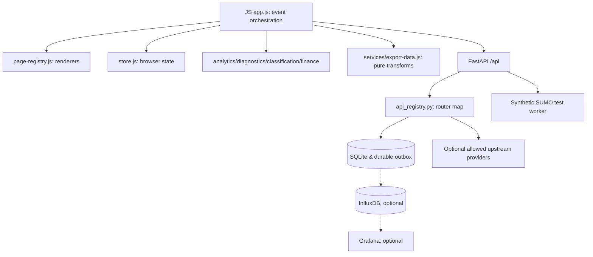

# Architecture: SIMPUL v1.2

## Design decisions

SIMPUL is a **modular monorepo** using native ES-module frontend, FastAPI backend and optional supporting services. The initial product is local-first and suitable for fieldwork without always-on connectivity. It deliberately avoids microservice infrastructure during research development.

## Dependencies at a glance

### Frontend contracts

| File | Responsibility | Dependency rule |
|:--|:--|:--|
| `js/app.js` | DOM, forms, modal lifecycle, request triggering | Can call pure functions and API; no new algorithmic core |
| `js/page-registry.js` | Route ID → render function | Must match `views` in `js/data.js` |
| `js/views/*` | HTML screens and UI labels | No backend secret or authorization logic |
| `js/store.js` | Browser state and old-state migration | Must preserve manual data |
| `js/services/csv.js` | CSV field escaping and row encoding | No UI or persistence effects |
| `js/services/export-data.js` | Source-aware export data transformations | No DOM, no filesystem writes |

**Standalone build:** `tools/build_standalone.py` recursively reads static relative named imports from `js/app.js`, validates paths/cycles and emits `tmp/bundled_app.js` and `SIMPUL_Standalone.html`. Changing ES module syntax may require upgrading the bundler. Do not load CDN scripts or runtime packages into standalone demo without redesigning this contract.

### Backend contracts

`server/api_registry.py` registers modular `APIRouter`s. `server/app.py` remains the FastAPI entrypoint and static file server. `server/simulation_engine.py` owns synthetic SUMO calculations; `server/simulation_api.py` owns HTTP job submission and polling. Each API adapter validates inputs via Pydantic, keeps credentials in process environment, and uses explicit HTTP failures for missing dependencies.

### Storage and provenance

1. Browser `localStorage` contains the demo workspace, manual unsynchronized observations and local review records.
2. Explicit sync sends source-labeled manual events to SQLite. Synthetic records must be rejected.
3. SQLite outbox queues minimised telemetry for InfluxDB; failed writes remain pending and retryable.
4. Grafana reads InfluxDB when monitoring is configured. Dashboard existence is not live interoperability verification.
5. Public news, AI summaries and model outputs are *not* promoted into field observations.

### Why these boundaries?

- **Agent readability:** ownership and entrypoints are explicit, and route/adapter changes are localized.
- **Testability:** CSV exports, finance and classification can be tested without a browser or third-party network.
- **Offline compatibility:** no backend is required to inspect the standalone demonstration.
- **Integrity:** source types and human review states survive across stages.
- **Cost:** the first local prototype avoids Kubernetes and paid infrastructure dependencies.

### Known shortcomings

The frontend action dispatcher in `js/app.js` remains concentrated in one file. It is intentionally left behavior-compatible in v1.2 rather than attempting a high-risk full rewrite; future extraction should be incremental and accompanied by browser flow tests. The SUMO worker is in-memory, the API lacks multi-user authorization, and provider calls require live deployment tests before real operational use.
