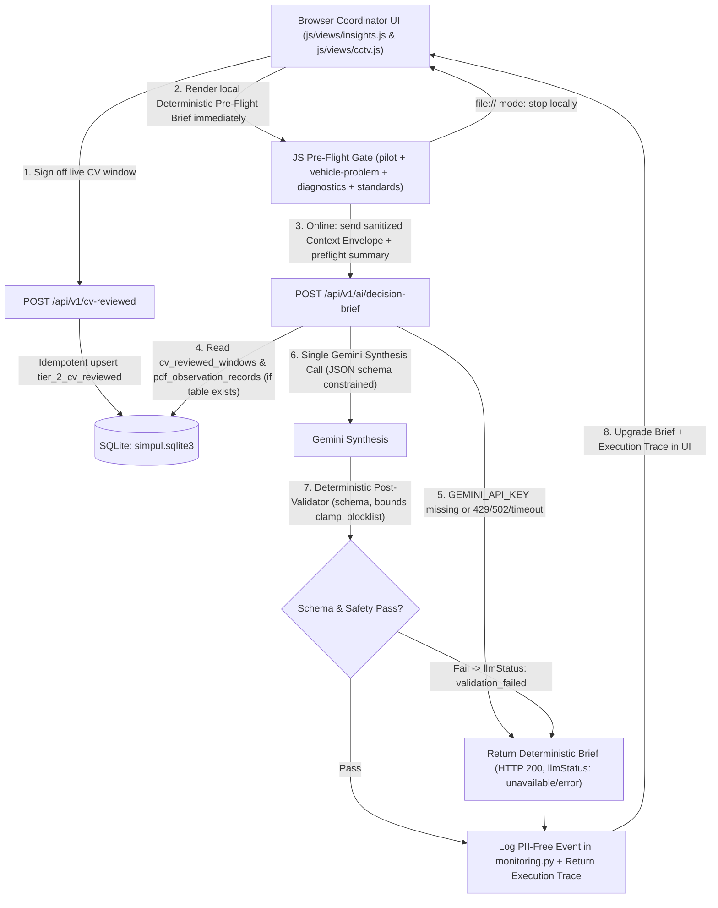

# Coordinator Decision Brief Workflow (Deterministic Guardrails + Bounded LLM)

*   **Author:** karolyangqian
*   **Status:** Proposed
*   **Date:** 2026-11-17

--------------------------------------------------------------------------------

## Overview

This feature extends SIMPUL's on-demand AI interpretation from a stateless four-list summary into an auditable **Coordinator Decision Brief** for field survey operations near MRT Fatmawati. It pairs deterministic pre-flight and post-validation rules (survey coverage, evidence quality, three-tier source separation, PII field exclusion, and simulation parameter bounds) with a single bounded LLM synthesis pass. Field coordinators use the brief to cross-check observer-entered logs, reviewed camera window summaries, contextual feeds, and traffic scenario drafts without adding autonomous enforcement or promoting unverified or synthetic outputs into primary field evidence.

--------------------------------------------------------------------------------

## The Problem

SIMPUL (*Sistem Inspeksi Mobilitas untuk Penataan Ulang Layanan*) moves through four stages: field observation, AI-assisted interpretation, scenario simulation (`A0` baseline curbside stopping, `A1` diversion to a dedicated under-station pickup bay, and `A2` dwell-time limit plus pedestrian detour rules), and human evaluation. Today, the interpretation endpoint (`gemini_insights` in `server/providers.py` behind `POST /api/ai/insights`) has four limitations for field coordinators:

1. **Disconnected evidence:** The backend prompt receives only four aggregate counts (`count`, `meanDwellSec`, `byType`, `byZone`) from manual observations. It ignores 12-slot survey coverage (`js/pilot.js`), field diagnostics and evidence gates (`js/diagnostics.js`, `js/standards.js`), manual `fieldReadings` (baseline traffic volume and queue counts), imported PDF records (`server/document_evidence.py`), arterial road-speed and weather context (`TomTom` and `Open-Meteo` in `server/providers.py`), and `A0`/`A1`/`A2` simulation results.
2. **Unactionable output:** Returning four prose lists (`summary`, `findings`, `limitations`, `nextSteps`) does not tell a coordinator which missing survey slot to schedule next, which `A0`/`A1`/`A2` parameters to test, or which obstruction reports need human field inspection.
3. **Isolated camera signals vs. uncalibrated risk:** External computer-vision (CV) detections (`js/cctv-controller.js`) remain presentation-only. Promoting unreviewed camera tracks directly into primary evidence violates SIMPUL's non-enforcement rules (`legalConclusion = 'NOT_DETERMINED'`) and bypasses the proposal's `F1 >= 0.80` event-detection validation gate (`reference/SIMPUL_iSeeDesignITB_Proposal.pdf`), while leaving reviewed camera counts isolated prevents them from flagging survey blind spots.
4. **Overengineering risk with multi-agent frameworks:** Open-ended multi-agent debate, dynamic LLM tool routing, or multi-round LLM critique loops add latency against SIMPUL's existing `25–45 s` client request timeout in `js/api.js`, consume Gemini quota on deterministic checks that existing JS domain modules already perform locally, and risk promoting synthetic `SUMO` (Simulation of Urban MObility) or contextual data into authoritative field claims.

--------------------------------------------------------------------------------

## Goals

*   **Actionable three-part Decision Brief:** Produce a structured brief containing (1) cross-tier evidence contradictions and next-session survey slot priorities, (2) candidate `A0`/`A1`/`A2` `ScenarioParams` hypotheses tagged `synthetic_hypothesis_uncalibrated`, and (3) a prioritized human field-inspection checklist.
*   **Reuse existing domain and monitoring modules:** Compose `js/pilot.js`, `js/vehicle-problem.js`, `js/diagnostics.js`, and `js/standards.js` for the **Deterministic Pre-Flight Gate**, reuse browser-fetched context via existing `/api/context/weather` and `/api/traffic/live` routes, and record execution audit events via `server/monitoring.py`.
*   **Strict three-tier provenance separation:** Enforce separate handling for `tier_1_manual` (observer-entered field logs and baseline readings), `tier_2_cv_reviewed` (aggregated zone/period counts from live external CV mode explicitly signed off by a coordinator), and `tier_3_contextual_unverified` (uploaded PDFs, `Open-Meteo` weather, `TomTom` road speed, `OpenStreetMap Overpass` Points of Interest, and synthetic `SUMO` metrics), rejecting synthetic 3D demo camera tracks from `cv_reviewed`.
*   **Single-pass bounded LLM synthesis & PII field exclusion:** Run at most 1 structured Gemini synthesis call per brief request (enforced by Gemini JSON schema + **Deterministic Post-Validator** in Python) and exclude free-text notes, reviewer labels, PDF file names, and identifying metadata from prompts and trace logs.
*   **Progressive UI & offline fallback:** Render the local deterministic brief immediately in the browser, upgrade it asynchronously with backend PDF/LLM synthesis when online, and preserve deterministic brief generation in `SIMPUL_Standalone.html` (`file://` offline build) and when `GEMINI_API_KEY` is unconfigured.

--------------------------------------------------------------------------------

## Non-Goals

*   **No autonomous case creation or priority overrides:** The workflow never writes directly to `responseCases` (manual operational follow-up cases) or overrides `js/classification.js` (`P1`–`P4` review priorities).
*   **No enforcement, identity recognition, or legal conclusions:** No license-plate recognition, facial recognition, raw video/frame uploads to Gemini, or traffic offence adjudication (`legalConclusion` remains `NOT_DETERMINED`).
*   **No synchronous `SUMO` runs or server-side external API fan-out:** The brief endpoint never triggers `netconvert`/`sumo` subprocesses and never opens outbound weather/traffic HTTP requests inside the brief call.
*   **No unbounded multi-agent loops or stochastic retry loops:** No dynamic LLM-selected tool calls, conversational agent swarms, or multi-round LLM repair calls.
*   **No uncalibrated real-world validation claims:** Candidate `A0`/`A1`/`A2` parameters and `cv_reviewed` counts do not claim MRT Fatmawati digital-twin calibration without separate field validation.

--------------------------------------------------------------------------------

## Open Questions

None.

--------------------------------------------------------------------------------

## Critical User Journeys (CUJs)

### CUJ 1: On-Demand Brief With Incomplete Survey Coverage

*   **Given**: A field coordinator has logged manual observations in `Zona A` and `Zona B`, has 0 manual sessions in `Zona C`, and has configured `GEMINI_API_KEY` on the FastAPI backend.
*   **When**: The coordinator triggers the on-demand Decision Brief from `js/views/insights.js`.
*   **Then**: The browser runs the **Deterministic Pre-Flight Gate** locally and renders deterministic coverage gaps immediately, then sends the sanitized pre-flight envelope to `POST /api/v1/ai/decision-brief`. The backend attaches local PDF counts, runs 1 bounded Gemini synthesis call, passes the **Deterministic Post-Validator**, logs a PII-free **Execution Trace** event via `server/monitoring.py`, and returns the upgraded brief prioritizing `Zona C` alongside bounded `A0`/`A1`/`A2` candidate parameters and a human inspection checklist.

### CUJ 2: Coordinator Sign-Off of External CV Window (`cv_reviewed`)

*   **Given**: An external CV model is connected to `js/views/cctv.js`, and the synthetic 3D simulation demo mode is inactive.
*   **When**: The coordinator selects a target zone (`Zona A`, `Zona B`, `Zona C`, or `Area A1`) and survey period (`Jam sibuk` peak or `Luar jam sibuk` off-peak), enters a reviewer label, and submits sign-off for the active CV window.
*   **Then**: Only aggregated zone counts and dwell metrics (no images, bounding boxes, track IDs, or personal identifiers) are cached in browser state (`cvReviewedSummaries`) and persisted via `POST /api/v1/cv-reviewed` to SQLite `cv_reviewed_windows` when online, while the CV window accumulator resets atomically so windows never double-count. Sign-off is blocked whenever synthetic demo mode is active.

### CUJ 3: Offline Standalone or Unconfigured Backend Fallback

*   **Given**: The coordinator opens `SIMPUL_Standalone.html` via `file://` or runs the server without `GEMINI_API_KEY` or `TOMTOM_API_KEY`.
*   **When**: The coordinator opens `js/views/insights.js` or requests a Decision Brief.
*   **Then**: In `file://` mode, the browser computes deterministic survey gaps, cross-tier mismatch flags, and heuristic `ScenarioParams` hints locally without runtime errors, labeling LLM synthesis and live feeds `unavailable`; when online without `GEMINI_API_KEY`, `POST /api/v1/ai/decision-brief` logs the **Execution Trace** and returns HTTP `200` with the deterministic brief and `llmStatus: 'unavailable'`.

--------------------------------------------------------------------------------

## Technical Plan (Architecture)

The system uses a **single-pass deterministic pre-/post-check pipeline wrapping a bounded LLM synthesis call**, while browser modules retain deterministic offline capability in `SIMPUL_Standalone.html`.

### Key Design Decisions

*   **Single-purpose synchronous HTTP contract:** `POST /api/v1/ai/decision-brief` consumes client-computed **Deterministic Pre-Flight Gate** summaries and cached context snapshots (no server-side external API fan-out) and executes at most 1 Gemini synthesis call under a route-specific `45,000 ms` client timeout.
*   **Hybrid state persistence with idempotent upserts:** Survey `sessions`, `sessionReviews`, and `surveyProtocol` stay browser-owned and travel inside the Context Envelope; coordinator-signed `cv_reviewed` windows cache locally in browser storage and upsert idempotently into SQLite `cv_reviewed_windows` by deterministic `windowId`.
*   **Zone harmonization:** `Area A1` (the dedicated under-station pickup bay adjacent to `Zona B` station entrance frontage in `js/fatmawati-layout.js`) stays isolated as `bayUtilization` telemetry inside `tier_2_cv_reviewed`, excluded from the 12-slot `Zona A`/`Zona B`/`Zona C` survey denominator (`3 zones x 2 periods x 2 replicates` in `js/pilot.js`).
*   **Single-owner rule evaluation & monitoring reuse:** All deterministic pre-flight rules run once in pure JS (composing `pilot.js`, `vehicle-problem.js`, `diagnostics.js`, and `standards.js`), avoiding dual Python/JS rule engines, and backend execution traces log into `server/monitoring.py` instead of introducing a separate `reasoning_runs` table.

### 1. Three-Tier Provenance Quarantine & Domain Mapping

Every input entering the decision-brief pipeline is tagged at the schema boundary and never merged into shared totals:

*   **`tier_1_manual`:** Aggregated observer-entered `manual` observations (durations, counts by `type` and `zone`, `yes`/`no`/`unknown` obstruction tallies, and `syntheticExcluded: true` verification), manual `fieldReadings` baseline counts, `js/diagnostics.js` warnings/gates, `js/standards.js` quality status, and 12-slot `surveyCoverage` (`Zona A`, `Zona B`, `Zona C` x `Jam sibuk` peak / `Luar jam sibuk` off-peak x `2` replicates). The browser Context Envelope is the authoritative `tier_1_manual` source for the coordinator's active workspace.
*   **`tier_2_cv_reviewed`:** Aggregated tumbling-window summaries accumulated in `js/cctv-controller.js` only while live external CV mode is active and atomically reset upon coordinator sign-off (`windowId`, `period`, `signedOffAt`, `windowStart`, `windowEnd`, `zone`, vehicle counts, mean dwell, and over-threshold count above `dwellThresholdSec`). Synthetic 3D demo tracks are rejected by both the browser gate and backend Pydantic validation. Reviewer labels are stored only in SQLite audit metadata under single-host operator trust (`server/security.py`) and excluded from LLM prompts and execution traces.
    *   **Zone Harmonization:** `Zona A`, `Zona B`, and `Zona C` map directly to `DEFAULT_PROTOCOL.zones` (`js/pilot.js`). Detections inside `Area A1` route into a separate `bayUtilization` telemetry bucket inside `tier_2_cv_reviewed`.
*   **`tier_3_contextual_unverified`:** Local `pdf_observation_records` (`reviewStatus = 'unverified'`), client-cached `Open-Meteo` weather, `TomTom` arterial road speed ratio, cached `Overpass` POIs, and optional simulation snapshot (`A0`/`A1`/`A2` heuristic or synthetic `SUMO` metrics, tagged `valid: false`).

### 2. Hybrid State Persistence, API Registry & Context Contracts

*   **Router Registration & Catalog:** New `/api/v1/...` routes register via `server/api_registry.py` (inheriting `server/security.py` local host policy, `SIMPUL_API_TOKEN`, same-origin checks, `no-store` headers, and mutation rate limits) and are tracked in `config/module-catalog.json`.
*   **`POST /api/v1/cv-reviewed`:** Performs idempotent upserts keyed by deterministic client `windowId` into `cv_reviewed_windows` (owned by `server/decision_brief.py` using `storage.connect()` with WAL mode enabled in `server/storage.py`). Online sign-offs also cache compact summaries in browser state (`cvReviewedSummaries`) so `SIMPUL_Standalone.html` retains offline continuity.
*   **`POST /api/v1/ai/decision-brief` (Synchronous):** Accepts a Pydantic Context Envelope containing:
    *   `manualSummary` (`syntheticExcluded: true`, aggregated counts without free-text notes),
    *   `preflightBrief` (pre-computed deterministic coverage gaps, diagnostic warnings, cross-tier flags, and deterministic fallback checklist/hypotheses from the browser),
    *   `cvReviewedIds` and optional unsynced `cvReviewedWindows` (`mode: 'ai'`, deduplicated by `windowId`),
    *   `cachedContext` (optional `weather`, `traffic`, `nearby`, and `projectGeo`, each with UTC timestamps checked against a 15-minute freshness TTL; missing/stale feeds are marked `unavailable` without server-side external API calls),
    *   `simulationSnapshot` (optional last simulation engine and clamped scenario parameters),
    *   `includeLocalPdf` (boolean controlling optional local SQLite PDF aggregation).
*   **Backward Compatibility:** `POST /api/ai/insights` in `server/extra_routes.py` remains unchanged.

### 3. Single-Owner Deterministic Pre-Flight Gate (Browser JS)

The **Deterministic Pre-Flight Gate** executes once in pure JS by composing `surveyCoverage`, `vehicleProblemSummary`, `diagnose`, `evidenceGate`, and `assessQuality`, plus deterministic cross-tier predicates evaluated over overlapping time windows:

*   *Coverage Gap:* `Zona A`/`Zona B`/`Zona C` slots with `completed < target` or `baseline == 0`.
*   *Bay vs. Curb Blind Spot:* `tier_2_cv_reviewed` shows elevated over-threshold stops in a `Zona A/B/C` slot (`zone` + `period`) with `0` accepted manual sessions, or `Area A1` `bayUtilization` remains empty while `Zona B` curb dwell exceeds `dwellThresholdSec`.
*   *Context vs. Curb Mismatch:* Fresh `TomTom` slowdown or active `Open-Meteo` rain while manual `laneBlocked='yes'` count is `0` and `unknown > 50%` of filtered manual events.
*   *Document Unverified Overlap (Backend Addendum):* If `includeLocalPdf` is enabled and `pdf_observation_records` exists in SQLite, `server/decision_brief.py` normalizes extracted zones to `Zona A/B/C` (mapping unrecognized strings to `'other_unmapped'`) and maps WIB timestamps to `'Jam sibuk'` or `'Luar jam sibuk'`, attaching unverified PDF overlap flags to the context bundle.

### 4. Single-Pass LLM Synthesis, Deterministic Post-Validator & Execution Trace

*   **Prompt-Serialization Allowlist:** Before calling Gemini, the backend serializes only numeric counts/ratios, deterministic pre-flight flag codes, and closed enum tokens (`Zona A`, `Zona B`, `Zona C`, `Area A1`, `Jemput`, `Turun`, `Menunggu`, `Jam sibuk`, `Luar jam sibuk`). Observation notes, `fieldReadings` notes, `sessionReviews` notes/reviewers, `reviewerLabel`, PDF file names, vehicle color strings, and OSM POI names are excluded.
*   **Single Synthesis Call (Gemini JSON Schema):** Outputs `DecisionBriefOutput` containing `contradictionsAndGaps` (each item carrying `evidenceLabel: 'requires_field_verification' | 'contextual_signal_only'` and `tier3ContextRefs`), `scenarioHypotheses` (candidate parameter values per `A0`/`A1`/`A2`, excluding RNG `seeds`), and `inspectionChecklist`.
*   **Deterministic Post-Validator:** Runs Python checks on the Gemini JSON response: (a) schema compliance and required `evidenceLabel` / `tier3ContextRefs` separation, (b) clamps any out-of-range `ScenarioParams` values strictly to `server/simulation_engine.py` bounds (recording `clampedFields` in the trace), (c) attaches immutable `legalConclusion = 'NOT_DETERMINED'` and `synthetic_hypothesis_uncalibrated` markers in Python, and (d) checks free-text fields against a deterministic regex blocklist for license-plate patterns, enforcement commands, and legal offence verdicts. If schema validation or the blocklist fails (or `GEMINI_API_KEY` is missing, or Gemini returns `429`/`502`/timeout), the endpoint returns HTTP `200` with the client's deterministic pre-flight brief and explicit `llmStatus` (`'ok'`, `'unavailable'`, `'validation_failed'`, or `'error'`).
*   **Execution Trace (`server/monitoring.py`):** Returns a PII-free `executionTrace` summary (`runId`, `promptVersion`, `tierCounts`, `providerStatuses`, `preflightFlags`, `clampedFields`, `llmStatus`, `validatorPassed`, `durationMs`) directly in the HTTP `200` response and logs a compact audit event via `monitoring.record_event(...)` into `operational_logs`.

### 5. Offline Standalone Fallback (`SIMPUL_Standalone.html`)

When `location.protocol === 'file:'`, `js/views/insights.js` skips network requests and renders the output of `js/decision-brief.js` directly (without mutating state during render), displaying deterministic coverage gaps, cross-tier flags, heuristic `ScenarioParams` hints, and the human inspection checklist with an `Offline / Deterministic Only (LLM unavailable)` banner while complying with `tools/build_standalone.py` static named ES import rules.

--------------------------------------------------------------------------------

## Alternatives Considered

### Alternative A: Multi-Agent Coordination Framework (AutoGen / CrewAI / Dynamic Tool Router)

*   **Pros**: Models open-ended debate between specialized personas and lets the LLM dynamically decide which backend tools or queries to invoke.
*   **Cons**: Multi-turn agent orchestration adds unpredictable latency against `js/api.js` timeouts, increases Gemini token/rate-limit consumption (`HTTP 429`), and requires duplicating browser-only state (`sessions`, `surveyProtocol`) on the backend just so tools can inspect it.
*   **Decision**: Rejected — SIMPUL reviews at most 12 planned survey sessions per corridor; browser-side deterministic pre-flight checks plus 1 bounded Gemini call achieve auditable outputs without multi-agent overhead.

### Alternative B: Raw CCTV Direct-to-Evidence (Unreviewed Camera Ingestion)

*   **Pros**: Directly turns connected security camera streams into vehicle dwell counts without requiring a manual coordinator review step.
*   **Cons**: Uncalibrated computer-vision counts (`F1 >= 0.80` not established) can contaminate observer-entered `tier_1_manual` observations, and direct camera-to-case ingestion conflicts with `AGENTS.md` non-enforcement and privacy constraints.
*   **Decision**: Rejected — unverified CV detections must stay quarantined from `tier_1_manual` and require explicit coordinator sign-off on aggregated counts before entering `tier_2_cv_reviewed`.

### Alternative C: Keep CCTV Strictly Display-Only (No `cv_reviewed` Tier)

*   **Pros**: Requires no new SQLite table, no sign-off UI in `js/views/cctv.js`, and eliminates risk of uncalibrated CV data influencing planning.
*   **Cons**: Prevents real external CV models from ever contributing blind-spot or pickup-bay utilization signals to survey dispatch or simulation hypotheses, even after human review.
*   **Decision**: Rejected — a coordinator-signed `tier_2_cv_reviewed` path (with synthetic demo tracks blocked) lets real CV detections inform dispatch without contaminating manual metrics.

### Alternative D: Multi-Round or 1-Retry LLM Evaluator-Optimizer Repair Loop

*   **Pros**: Uses iterative LLM self-critique or repair calls to revise phrasing or fix out-of-range outputs.
*   **Cons**: Doubles worst-case Gemini latency (risking client timeouts) and consumes extra quota on invariants that Gemini `responseSchema`, Python clamping, and deterministic blocklists already enforce.
*   **Decision**: Rejected — single-pass `responseSchema` generation + Python numeric clamping + immediate deterministic fallback on safety/schema violations delivers predictable latency and zero wasted retries.

### Alternative E: Server-Side `ThreadPoolExecutor` Context Fan-Out or Async Job Queue

*   **Pros**: Lets the brief endpoint fetch missing weather/traffic feeds in parallel or run background jobs.
*   **Cons**: Duplicates existing `/api/context/weather` and `/api/traffic/live` endpoints (`server/extra_routes.py`), couples LLM latency to external HTTP jitter, or requires polling loops and job retention state.
*   **Decision**: Rejected — reading client-cached context snapshots (pre-fetched via existing context endpoints when desired) keeps `/api/v1/ai/decision-brief` single-purpose and fast.

### Alternative F: Dual Python/JS Pre-Flight Rule Engine & Custom `reasoning_runs` Table

*   **Pros**: Allows standalone backend callers to recompute browser pre-flight rules in Python and stores full brief history in a separate SQLite table.
*   **Cons**: Dual rule code drifts between Python and JS (`tools/build_standalone.py` cannot bundle `.json` config imports directly), and `reasoning_runs` duplicates `server/monitoring.py`'s existing `operational_logs` table with 90-day pruning.
*   **Decision**: Rejected — computing pre-flight rules once in JS (`js/decision-brief.js`) and logging audit events to `server/monitoring.py` eliminates dual-language drift and redundant storage code.

### Alternative G: Merging `Area A1` into `Zona B` or Expanding Survey Protocol to 16 Slots

*   **Pros**: Unifies zone IDs across `CCTV_ZONES` and `DEFAULT_PROTOCOL.zones` without needing a separate `bayUtilization` bucket.
*   **Cons**: Aliasing `Area A1` into `Zona B` conflates off-street bay usage with curbside blocking during `A0` vs. `A1` analysis; expanding `DEFAULT_PROTOCOL.zones` alters the 12-session proposal baseline and creates unfillable baseline slots when the `A1` bay is absent.
*   **Decision**: Rejected — isolating `Area A1` as `bayUtilization` telemetry preserves the 12-session `Zona A`/`Zona B`/`Zona C` protocol slot counts while still tracking bay usage.

--------------------------------------------------------------------------------

## Risks & Mitigations

*   **Prompt Injection & Accidental PII Exposure:** Untrusted text in PDFs (`file_name`), OSM POIs (`name`), `Event.note`, `fieldReadings[].note`, `sessionReviews[].note`/`.reviewer`, or `reviewerLabel` could inject prompt instructions or leak operator identities. **Mitigation:** Enforce the prompt-serialization allowlist (numbers, deterministic flag codes, and closed enums only) and exclude all free-text fields from prompts and `monitoring.py` audit details.
*   **Gemini Quota (`429`) & Timeout Exhaustion:** Slow or rate-limited Gemini calls could stall or fail coordinator reviews. **Mitigation:** Render the local deterministic brief immediately (`< 50 ms` target), cap the single Gemini call at `timeout=25` with bounded `max_output_tokens`, enforce `server/security.py` mutation limits, and return HTTP `200` with the deterministic brief and `llmStatus: 'unavailable' | 'error'` on `429`/`502`/timeout/missing key.
*   **SQLite Lock Contention Across Modules:** Concurrent writes across `observations`, `field_readings`, `operational_logs`, `pdf_observation_records`, and `cv_reviewed_windows` could trigger `database is locked`. **Mitigation:** Configure `PRAGMA journal_mode=WAL` and `PRAGMA busy_timeout=8000` in `server/storage.py` `connect()`, and access SQLite strictly through `storage.connect()` so test monkeypatching (`storage.DB`) remains isolated.
*   **Unbounded `localStorage` & Stale Context Bias:** Repeating CV sign-offs or using days-old weather/TomTom snapshots could bloat browser storage or trigger false mismatch warnings. **Mitigation:** Cap `cvReviewedSummaries` at the newest `200` entries (`.slice(-200)`) deduplicated by `windowId`, attach UTC `checkedAt` timestamps on `state.context`, and ignore cached feeds older than `15` minutes.
*   **Single-Host Operator Trust (`mode: 'ai'`):** On localhost without `SIMPUL_API_TOKEN` enforcement, `POST /api/v1/cv-reviewed` trusts the client-asserted `mode: 'ai'` flag. **Mitigation:** Document this boundary under `server/security.py`'s single-host prototype model, require explicit coordinator sign-off per window, and keep `tier_2_cv_reviewed` quarantined from `tier_1_manual`.

--------------------------------------------------------------------------------

## Non-Functional Requirements

*   **Security & Privacy:** All new routes register via `server/api_registry.py` under `/api/v1/...` and inherit `server/security.py` middleware (`SIMPUL_API_TOKEN`, local host allowlist, same-origin checks, `Cache-Control: no-store`, and `90/60s` mutation rate limits). All brief strings rendered in `js/views/insights.js` pass through `safe(...)` (`js/util.js`).
*   **Performance & Latency:** Single-pass Gemini synthesis uses `timeout=25` and `max_output_tokens=1400`, `POST /api/v1/ai/decision-brief` uses a `45,000 ms` route-specific timeout in `js/app.js`, and local deterministic brief generation targets `< 50 ms` for bounded workspace inputs (`<= 1,000` observations, `<= 3,000` `fieldReadings`).
*   **Rollout & Backward Compatibility:** `POST /api/ai/insights` and the existing `aiInsights` card remain intact. `js/store.js` (`sanitize`) initializes `cvReviewedSummaries: []` and `decisionBrief: null` with empty defaults for existing `simpul_workspace_v2` backups without dropping prior observations. All JS additions obey `tools/build_standalone.py` static named ES import constraints and avoid `U+2022` + space (`\u2022 `) in packaged files.

--------------------------------------------------------------------------------

## Detailed Implementation Plan

### Target Scope & File Boundary

*   **Modify (Backend & Shared Tests):** `server/storage.py`, `server/providers.py`, `server/api_registry.py`, `tests/test_api_registry.py`
*   **Create (Backend & Tests):** `server/decision_brief.py`, `tests/test_decision_brief_api.py`
*   **Modify (Frontend & Tests):** `js/data.js`, `js/store.js`, `js/cctv-controller.js`, `js/views/cctv.js`, `js/app.js`, `js/views/insights.js`, `package.json`, `tests/test_state_migration.mjs`, `tests/test_cctv.mjs`
*   **Create (Frontend & Tests):** `js/decision-brief.js`, `tests/test_decision_brief.mjs`
*   **Modify (Catalog & Docs):** `config/module-catalog.json`, `docs/API_REFERENCE.md`, `README.md`
*   **Regenerated Outputs (via `tools/build_standalone.py`):** `SIMPUL_Standalone.html`, `sw.js`

---

### Exact Schemas & Deterministic Contracts

#### A. `CvReviewedWindowInput` & `cv_reviewed_windows` Table (`server/decision_brief.py`)
*   **Pydantic Model (`ConfigDict(extra='forbid')`):**
    *   `windowId`: `str = Field(min_length=3, max_length=80, pattern=r'^[a-zA-Z0-9_-]+$')` (generated deterministically by client as `cv-<zoneSlug>-<peak|off>-<startCompactUtc>-<endCompactUtc>`, where `<startCompactUtc>` / `<endCompactUtc>` use UTC `YYYYMMDDTHHMMSSZ`)
    *   `signedOffAt`, `windowStart`, `windowEnd`: ISO 8601 strings validated with mandatory timezone offset (`tzinfo is not None`)
    *   `reviewerLabel`: `str = Field(min_length=2, max_length=60)` (trimmed; excluded from Gemini prompts and `executionTrace`)
    *   `zone`: `Literal['Zona A', 'Zona B', 'Zona C', 'Area A1']`
    *   `period`: `Literal['Jam sibuk', 'Luar jam sibuk']`
    *   `mode`: `Literal['ai']` (any `'demo'` or unknown value returns HTTP `422`)
    *   `vehicleCountsByClass`: `dict[Literal['car', 'motorcycle', 'bus'], int]` where each count is `0 <= v <= 10000`
    *   `meanDwellSec`: `float = Field(ge=0, le=3600)`
    *   `overThresholdCount`: `int = Field(ge=0, le=10000)`
*   **SQLite Table (`init_cv_reviewed_table(c)` in `server/decision_brief.py`):**
    *   `cv_reviewed_windows(window_id TEXT PRIMARY KEY, signed_off_at TEXT NOT NULL, reviewer_label TEXT NOT NULL, zone TEXT NOT NULL, period TEXT NOT NULL, is_bay_zone INTEGER NOT NULL, window_start TEXT NOT NULL, window_end TEXT NOT NULL, mode TEXT NOT NULL, vehicle_counts_json TEXT NOT NULL, mean_dwell_sec REAL NOT NULL, over_threshold_count INTEGER NOT NULL, payload_hash TEXT NOT NULL, created_at TEXT DEFAULT CURRENT_TIMESTAMP)`
*   **Idempotent Upsert Semantics (`POST /api/v1/cv-reviewed`):**
    *   Compute SHA-256 `payload_hash` of normalized fields (`zone`, `period`, `windowStart`, `windowEnd`, `vehicleCountsByClass`, `meanDwellSec`, `overThresholdCount`).
    *   If `window_id` does not exist: insert row and return HTTP `200` `{status: 'inserted', windowId}`.
    *   If `window_id` exists with identical `payload_hash`: return HTTP `200` `{status: 'already_present', windowId}`.
    *   If `window_id` exists with different `payload_hash`: raise HTTP `409` (`'windowId sudah terdaftar dengan ringkasan berbeda (windowId already registered with a different summary).'`).

#### B. Sub-Object Schemas, `DecisionBriefRequest` & `DecisionBriefResponse` (`server/decision_brief.py`)
*   **Shared Brief Sub-Objects (`ConfigDict(extra='forbid')`):**
    *   `BriefFlagItem`: `{code: Literal['COVERAGE_GAP','BAY_CURB_BLIND_SPOT','CONTEXT_CURB_MISMATCH','PDF_UNVERIFIED_OVERLAP','DIAGNOSTIC_WARNING'], zone: Literal['Zona A','Zona B','Zona C','Area A1','Corridor'], period: Literal['Jam sibuk','Luar jam sibuk','All'], reason: str (1..300), evidenceLabel: Literal['requires_field_verification','contextual_signal_only'], sourceTiersUsed: list[Literal['tier_1_manual','tier_2_cv_reviewed','tier_3_contextual_unverified']], tier3ContextRefs: list[str] (max 10)}`
    *   `ScenarioHypothesis`: `{scenario: Literal['A0','A1','A2'], title: str (1..120), rationale: str (1..300), params: dict[Literal['traffic','pickupShare','dwell','diversion','ruleDwell','pedestrianDetour'], int | float], label: Literal['synthetic_hypothesis_uncalibrated']}`
    *   `ChecklistItem`: `{zone: Literal['Zona A','Zona B','Zona C','Area A1'], period: Literal['Jam sibuk','Luar jam sibuk'], question: str (1..240), evidenceLabel: Literal['requires_field_verification','contextual_signal_only']}`
*   **`DecisionBriefRequest` (`ConfigDict(extra='forbid')`):**
    *   `manualSummary`: `{syntheticExcluded: Literal[True], totalEvents: int (0..100000), byType: dict[Literal['Jemput','Turun','Menunggu'], int], byZone: dict[Literal['Zona A','Zona B','Zona C'], int], meanDwellSec: float | None (0..3600), overThresholdCount: int (0..100000), impacts: {laneYes: int, laneUnknown: int, pedYes: int, pedUnknown: int, queueYes: int}}`
    *   `surveyCoverage`: `{completedSlots: int (0..30), targetSlots: int (1..30, default 12), baselineIntervals: int (0..3000), followupIntervals: int (0..3000), missingSlots: list[{zone: Literal['Zona A','Zona B','Zona C'], period: Literal['Jam sibuk','Luar jam sibuk'], completed: int (0..5), target: int (1..5)}]}`
    *   `preflightBrief`: `{contradictionsAndGaps: list[BriefFlagItem], scenarioHypotheses: list[ScenarioHypothesis], inspectionChecklist: list[ChecklistItem], diagnosticWarningsCount: int (0..100), qualityStatus: Literal['not_ready','exploratory_only']}`
    *   `cvReviewedIds`: `list[str]` (max 50 items, matching `windowId` regex)
    *   `cvReviewedWindows`: `list[CvReviewedWindowInput]` (max 50 items, for unsynced local windows; read-only during brief generation and deduplicated by `windowId` against SQLite rows)
    *   `cachedContext`: `{projectGeo: {lat: float, lon: float} | None, weather: {checkedAt: str | None, rain: float | None, weatherCode: int | None} | None, traffic: {checkedAt: str | None, speedRatio: float | None} | None, nearby: {checkedAt: str | None, count: int | None} | None}`
    *   `simulationSnapshot`: `{engine: Literal['heuristic','sumo'] | None, scenario: dict[Literal['traffic','pickupShare','dwell','diversion','ruleDwell','pedestrianDetour'], int | float] | None, scenarioClamped: bool = False} | None`
    *   `includeLocalPdf`: `bool = True`
*   **`DecisionBriefResponse` (always HTTP `200` for valid request payloads, including missing `GEMINI_API_KEY` or Gemini/validation failures):**
    *   `brief`: `{contradictionsAndGaps: list[BriefFlagItem], scenarioHypotheses: list[ScenarioHypothesis], inspectionChecklist: list[ChecklistItem], legalConclusion: Literal['NOT_DETERMINED'], bayUtilization: {windows: int, totalVehicles: int, meanDwellSec: float | None, overThresholdCount: int}}` (where `bayUtilization.meanDwellSec` is the vehicle-weighted mean across non-empty `Area A1` windows, or `None`/`null` when `totalVehicles == 0`)
    *   `llmStatus`: `Literal['ok', 'unavailable', 'validation_failed', 'error']`
    *   `llmModel`: `str | None`
    *   `pdfSummary`: `{available: bool, totalRecords: int, byZonePeriod: dict[str, int]}` (using `'|'` keys such as `'Zona A|Jam sibuk'`)
    *   `executionTrace`: `{runId: str, promptVersion: 'decision-brief-v1', tierCounts: {manualEvents: int, cvReviewedWindows: int, pdfRecords: int}, providerStatuses: {gemini: Literal['ok','unavailable','validation_failed','error'], weather: Literal['fresh','stale','unavailable','project_geo_unset'], traffic: Literal['fresh','stale','unavailable','project_geo_unset'], nearby: Literal['fresh','stale','unavailable'], pdf: Literal['available','unavailable']}, preflightFlags: list[str], clampedFields: list[str], llmStatus: Literal['ok','unavailable','validation_failed','error'], validatorPassed: bool, durationMs: int}` (where `tierCounts.cvReviewedWindows` counts unique deduplicated windows across `Zona A`/`B`/`C` and `Area A1`, and `preflightFlags` lists unique triggered `BriefFlagItem.code` values)
*   **Gemini `responseSchema` (`server/decision_brief.py`):**
    *   Enforces `{contradictionsAndGaps, scenarioHypotheses, inspectionChecklist}` matching the exact field names and `enum` constraints above (`code`, `zone`, `period`, `scenario`, `evidenceLabel`, `sourceTiersUsed`). Python attaches `label = 'synthetic_hypothesis_uncalibrated'` and `legalConclusion = 'NOT_DETERMINED'` deterministically after parsing.

#### C. Deterministic Post-Validator Bounds & Blocklist (`server/decision_brief.py`)
*   **Authoritative `ScenarioParams` Bounds (matching `server/simulation_engine.py:24–30`):**
    *   `A0`: `{traffic: [200, 1500], pickupShare: [0, 45], dwell: [5, 180]}`
    *   `A1`: `A0` keys + `{diversion: [0, 100]}`
    *   `A2`: `A0` keys + `{ruleDwell: [5, 120], pedestrianDetour: [0, 500]}`
    *   `seeds` is excluded from LLM-proposed hypotheses. Out-of-range numeric values returned by Gemini are clamped to these ranges and recorded in `executionTrace.clampedFields`.
*   **Deterministic Blocklist Regex (checked across all Gemini text fields):**
    *   Indonesian plate format (checked **case-sensitively**, uppercase letters only): `\b[A-Z]{1,2}\s?\d{1,4}\s?[A-Z]{1,3}\b`
    *   Plate labels & enforcement/legal-verdict terms (checked **case-insensitively**): `\b(plat nomor|nomor polisi|nopol|tilang|denda|sita|penindakan|tindak pidana|melanggar hukum|terbukti bersalah|pelanggaran pidana|hukuman)\b` *(plate number, traffic ticket, fine, seizure, enforcement, criminal offence, unlawful, proven guilty, penalty)*
    *   If Gemini output fails JSON schema parsing, omits required `evidenceLabel` / `tier3ContextRefs`, or matches the blocklist, discard Gemini output and populate `response.brief` from `preflightBrief` (preserving `legalConclusion: 'NOT_DETERMINED'` and computed `bayUtilization`) with `llmStatus: 'validation_failed'` and `validatorPassed: false`.

---

### Phased Implementation Steps & Per-Phase Checkpoints

#### Phase 1: Shared SQLite Pragmas & Provider Helpers
1. **`server/storage.py` (Modify):**
   *   **Proposed Changes**: Inside `connect()` (lines 62–80), increase `sqlite3.connect(DB, timeout=8, factory=_ManagedConnection)` and execute `c.execute('PRAGMA journal_mode=WAL')` and `c.execute('PRAGMA busy_timeout=8000')` before creating existing tables.
   *   **Rationale**: Prevents `database is locked` contention across `observations`, `field_readings`, `operational_logs`, `pdf_observation_records`, and `cv_reviewed_windows` while preserving `storage.connect()` as the single connection factory for test monkeypatching (`storage.DB`).
2. **`server/providers.py` (Modify):**
   *   **Proposed Changes**: Define `ProviderError(status_code: int, detail: str)` and extract `gemini_generate_json(prompt: str, schema: dict, *, timeout: int = 25, temperature: float = 0.2, max_output_tokens: int | None = 1400) -> tuple[str, dict]` handling `GEMINI_API_KEY` validation (raising `ProviderError(503, ...)`), `GEMINI_MODEL` validation, `generationConfig` (`responseMimeType`, `responseSchema`, `temperature`, plus optional `maxOutputTokens` when not `None`), and upstream errors (raising `ProviderError` with `429` on `HTTPError.code == 429` and `502` on other `HTTPError`/transport/JSON errors). Refactor `gemini_insights()` to call `gemini_generate_json(..., timeout=35, max_output_tokens=None)` and catch `ProviderError`, raising `HTTPException(503, ...)` on `503` and `HTTPException(502, ...)` on all other codes (preserving `/api/ai/insights` behavior unchanged).
   *   **Rationale**: Shares Gemini REST transport while giving `server/decision_brief.py` typed `429`/`502`/`503` differentiation without altering `/api/ai/insights`.
*   **Phase 1 Checkpoint:** `python tests/test_api.py && python -m pytest -q tests/test_security_hardening.py`

#### Phase 2: Backend Decision Brief Router, Registry & Contract Tests
3. **`server/decision_brief.py` (Create):**
   *   **Proposed Changes**: Define `APIRouter(prefix='/api/v1', tags=['Decision brief'])`, SQLite `cv_reviewed_windows` DDL via `storage.connect()` (never importing `DB` by value), `POST /api/v1/cv-reviewed` idempotent upsert, and `POST /api/v1/ai/decision-brief`:
       *   Query `sqlite_master` before reading `pdf_observation_records`; if absent, return `{available: False, totalRecords: 0, byZonePeriod: {}}` with `providerStatuses.pdf = 'unavailable'`. If present, normalize extracted `zone` strings via case-insensitive regex (`\bzon[ae]\s*a\b` -> `'Zona A'`, `b` -> `'Zona B'`, `c` -> `'Zona C'`, else `'other_unmapped'`) and `at` (`+07:00`) to `'Jam sibuk'` (`06:00–09:59`, `16:00–20:59` WIB) or `'Luar jam sibuk'`, counting only `byZonePeriod` totals (`'<zone>|<period>'`, never passing `file_name` or `color`). When `pdfSummary.byZonePeriod` has `count > 0` for a `'Zona A|B|C|...'` key matching `surveyCoverage.missingSlots`, add `'PDF_UNVERIFIED_OVERLAP'` to `executionTrace.preflightFlags`, pass that overlap flag to the Gemini prompt, and append a `PDF_UNVERIFIED_OVERLAP` `BriefFlagItem` (`evidenceLabel: 'contextual_signal_only'`, `sourceTiersUsed: ['tier_3_contextual_unverified']`) into `response.brief.contradictionsAndGaps` whenever `llmStatus !== 'ok'`.
       *   Load `cv_reviewed_windows` rows matching `cvReviewedIds` and merge/deduplicate with unsynced `cvReviewedWindows` by `windowId`, computing `Zona A/B/C` slot counts and isolated `Area A1` `bayUtilization` (with vehicle-weighted `meanDwellSec`).
       *   Evaluate `cachedContext` freshness (`checkedAt` UTC within `15` min -> `'fresh'`, older -> `'stale'`; `projectGeo is None` -> `'project_geo_unset'` for `weather`/`traffic`; missing -> `'unavailable'`).
       *   Build allowlisted prompt JSON (`promptVersion = 'decision-brief-v1'`); if `GEMINI_API_KEY` is missing (`ProviderError(503)`), populate `response.brief` from `preflightBrief` with `llmStatus='unavailable'` (HTTP `200`); otherwise call `gemini_generate_json(..., timeout=25, max_output_tokens=1400)`, run **Deterministic Post-Validator** (schema, bounds clamping, `legalConclusion='NOT_DETERMINED'`, blocklist), and populate `response.brief` from `preflightBrief` on validation failure (`llmStatus='validation_failed'`) or upstream `ProviderError` (`llmStatus='error'`).
       *   Log PII-free audit event via `monitoring.record_event('decision_brief', 'brief_generated', ref_id=run_id, detail=f'llm={llm_status}')`.
   *   **Rationale**: Implements the single-pass backend brief pipeline, provenance quarantine, and `monitoring.py` audit integration.
4. **`server/api_registry.py` and `tests/test_api_registry.py` (Modify):**
   *   **Proposed Changes**: Register `('decision_brief', decision_brief_router)` in `API_ROUTERS` (`server/api_registry.py`). Update `tests/test_api_registry.py:9` from `== 9` to `== 10` and add `/api/v1/cv-reviewed` and `/api/v1/ai/decision-brief` to `test_required_api_surfaces_present()`.
   *   **Rationale**: Exposes the new router via SIMPUL's registry and keeps registry tests green.
5. **`tests/test_decision_brief_api.py` (Create):**
   *   **Proposed Changes**: Test: (a) `POST /api/v1/cv-reviewed` rejecting `mode='demo'` with `422`, rejecting missing `period` with `422`, inserting `mode='ai'` (`200`), idempotent duplicate (`200` `already_present`), and conflicting payload (`409`); (b) `POST /api/v1/ai/decision-brief` with missing `GEMINI_API_KEY` (`200`, `llmStatus='unavailable'`), fresh DB without `pdf_observation_records` (`200`, no `OperationalError`), PDF overlap merged when `llmStatus !== 'ok'`, mocked nominal Gemini response (`llmStatus='ok'`, `Area A1` isolated into `bayUtilization`, `reviewerLabel` absent from prompt captured in mock), out-of-range `ScenarioParams` clamped (`clampedFields` populated), blocklist/schema failure (`llmStatus='validation_failed'`), Gemini `429`/timeout (`200`, `llmStatus='error'`), and `monitoring.records()` event recorded; (c) regression test (`python tests/test_api.py`) verifying `POST /api/ai/insights` remains unchanged.
   *   **Rationale**: Verifies every backend contract, failure fallback, and privacy boundary using `storage.DB` temp-dir isolation.
*   **Phase 2 Checkpoint:** `python tests/test_api.py && python -m pytest -q tests/test_api_registry.py tests/test_decision_brief_api.py tests/test_security_hardening.py`

#### Phase 3: Frontend Workspace State & Pure Deterministic Brief Composer
6. **`js/data.js` and `js/store.js` (Modify):**
   *   **Proposed Changes**: In `js/data.js`, add `traffic: null` to `initialData().context` (line 35), and add `cvReviewedSummaries: []` and `decisionBrief: null`. In `js/store.js` `sanitize()`, retain only `cvReviewedSummaries` items with `mode === 'ai'` and valid `windowId`, deduplicated by `windowId` and capped at newest `200` (`.slice(-200)`), and preserve `decisionBrief` as object or `null`.
   *   **Rationale**: Ensures `state.context.traffic` exists consistently and prior `simpul_workspace_v2` backups migrate without losing observations.
7. **`js/decision-brief.js` (Create):**
   *   **Proposed Changes**: Pure ES module using static named relative imports (`surveyCoverage` from `./pilot.js`, `vehicleProblemSummary` from `./vehicle-problem.js`, `diagnose`, `evidenceGate` from `./diagnostics.js`, `assessQuality` from `./standards.js`) with unique non-colliding top-level helper names (`tools/build_standalone.py` safety). Export:
       *   `buildBriefEnvelope(state)`: Calls `vehicleProblemSummary(state.observations, {source: 'manual'}, state.fieldSettings?.dwellThresholdSec)`, extracts only aggregate counts (omitting raw `.filtered` events and all `note`/`reviewer` fields from observations, `fieldReadings`, and `sessionReviews`), buckets `manualSummary.byZone` strictly to `'Zona A' | 'Zona B' | 'Zona C'` (filtering out any custom/legacy zone keys so `extra='forbid'` never fails), computes `surveyCoverage(state)`, `diagnose(state.fieldReadings || [], state.observations || [], state.fieldSettings)`, `evidenceGate(...)`, and `assessQuality(state)` safely when `fieldReadings` is empty, selects newest `<= 50` `cvReviewedSummaries` (`cvReviewedIds` for all, `cvReviewedWindows` stripping `synced` for unsynced windows), projects only `{lat, lon}` from `state.project?.geo` and allowlisted fields from `state.context` (`weather?.checkedAt`, `traffic?.checkedAt || traffic?.retrievedAtUtc`, `nearby?.checkedAt`), clamps `state.scenario` to the 6 numeric `simulation_engine.py` bounds (`scenarioClamped: true` if adjusted, excluding `seeds`), and packages `preflightBrief`.
       *   `buildDeterministicBrief(state)`: Applies the **Deterministic Pre-Flight Gate** to return the unified `DecisionBriefResponse` shape (`brief: {contradictionsAndGaps, scenarioHypotheses, inspectionChecklist, legalConclusion: 'NOT_DETERMINED', bayUtilization}`, `llmStatus: 'unavailable'`, `llmModel: null`, `pdfSummary: {available: false, totalRecords: 0, byZonePeriod: {}}`, `executionTrace: {runId: 'local-deterministic', promptVersion: 'decision-brief-v1', ...}`). Emits `BriefFlagItem`s (`COVERAGE_GAP`; `BAY_CURB_BLIND_SPOT` when `Area A1` `bayUtilization.totalVehicles === 0` with `Zona B` over-threshold `>= 3` or `Zona A/B/C` CV over-threshold `>= 3` with `0` accepted manual sessions; `CONTEXT_CURB_MISMATCH` when fresh `TomTom speedRatio < 0.6` or `rain > 0` / `weatherCode >= 51` with `0` `laneBlocked='yes'` and `unknown > 50%`; `DIAGNOSTIC_WARNING` from `diagnose()`), deterministic `A0`/`A1`/`A2` `scenarioHypotheses` (`A0`: `{traffic, pickupShare, dwell}`; `A1` if `Area A1` `totalVehicles === 0` or `Zona B` high dwell/waiting: adds `diversion: clamp(max(60, s.diversion), 0, 100)`; `A2` if `waiting > 0` or `overThresholdCount > 0`: adds `ruleDwell: clamp(round(dwellThresholdSec / 2), 5, 120)` and `pedestrianDetour`), and `inspectionChecklist`.
       *   `normalizeDecisionBrief(apiResponse, state)`: Merges server `brief`, `llmStatus`, `pdfSummary`, and `executionTrace` onto `buildDeterministicBrief(state)` defaults, preserving deterministic fields if any optional sub-field is absent without mutating input state.
   *   **Rationale**: Single source of truth for **Deterministic Pre-Flight Gate** rules, composing SIMPUL's existing domain modules and powering offline `SIMPUL_Standalone.html`.
8. **`package.json`, `tests/test_decision_brief.mjs`, and `tests/test_state_migration.mjs` (Modify / Create):**
   *   **Proposed Changes**: Add `node tests/test_decision_brief.mjs` to `package.json:7` `"test"`. Create `tests/test_decision_brief.mjs` testing: `note`/`reviewer` omission, `syntheticExcluded: true` with `demo` events ignored, non-`Zona A/B/C` zone filtering without `422` leakage, `50`-window slice and `synced` field stripping, `Area A1` routed to `bayUtilization` without altering `pilot.js` 12-slot totals, `15`-min `checkedAt`/`retrievedAtUtc` TTL expiry, exact mismatch triggers (`speedRatio < 0.6` + `unknown > 50%`), deterministic `A0`/`A1`/`A2` heuristic parameter formulas, and `ScenarioParams` clamping (`scenarioClamped`). Update `tests/test_state_migration.mjs` to assert pre-existing `simpul_workspace_v2` payloads migrate with `cvReviewedSummaries: []`, `decisionBrief: null`, and `context.traffic: null`.
   *   **Rationale**: Ensures new pure JS logic and state migrations execute inside `npm test` and `npm run verify`.
*   **Phase 3 Checkpoint:** `npm test`

#### Phase 4: CCTV Window Accumulator, Coordinator UI, Standalone Build & Docs
9. **`js/cctv-controller.js` and `js/views/cctv.js` (Modify):**
   *   **Proposed Changes**: In `js/cctv-controller.js`, add tumbling window accumulator `rt.aiWindow` keyed per zone (`{byZone: {'Zona A': {startedAt, counts: {car:0, motorcycle:0, bus:0}, dwellSum:0, dwellCount:0, overThresholdCount:0, countedIds: Set}, ...}}`). Update the zone bucket in `closeTrack()` (for `dwellSec >= STOP_LOG_SEC`), AND have `getAiWindowSummary(zone)` include both committed `byZone[zone]` totals and any currently-stopped active tracks in `rt.tracks` (`t.zone === zone && t.dwellSec >= STOP_LOG_SEC && !countedIds.has(id)`), returning `{zone, windowStart, windowEnd, vehicleCountsByClass, totalVehicles, meanDwellSec, overThresholdCount}` (or `null` when `rt.mode !== 'ai'`). `resetAiWindow(zone)` clears `byZone[zone]` counters, sets `byZone[zone].startedAt = new Date().toISOString()`, and retains active stopped track IDs in `countedIds` so active vehicles are never double-counted across consecutive windows. Clear all `byZone` buckets when `ingestDetections()` transitions to `rt.mode === 'ai'`, export no track IDs, and keep `updateState`, `localStorage`, and `fetch(` completely absent from both code and comments (`tests/test_cctv.mjs:36–39`). In `js/views/cctv.js`, add the gated **"Catat ringkasan ke `cv_reviewed` (Log summary to `cv_reviewed`)"** panel (dynamically enabled/disabled by `drawPanels()` when `rt.mode === 'ai'`) with `data-cv-zone` selector (`Zona A`, `Zona B`, `Zona C`, `Area A1`), `data-cv-period` selector (`'Jam sibuk' | 'Luar jam sibuk'`), `data-cv-reviewer` input, and submit button (`data-action="cv-signoff-window"`).
   *   **Rationale**: Implements disjoint per-zone tumbling-window CV aggregation (including active stopped vehicles) without breaking presentation-only module boundaries.
10. **`js/app.js` and `js/views/insights.js` (Modify):**
    *   **Proposed Changes in `js/app.js`:**
        *   In the `fetch-weather` / `fetch-traffic` / `fetch-nearby` handler (`line 197`), attach `checkedAt: new Date().toISOString()` onto `state.context[key]`.
        *   Add `cv-signoff-window` handler: read `[data-cv-zone]`, `[data-cv-period]`, `[data-cv-reviewer]`; validate `reviewerLabel.trim().length >= 2` and `summary?.totalVehicles > 0` (toast error without resetting `rt.aiWindow` if invalid); build deterministic `windowId` (`cv-<zoneSlug>-<peak|off>-<startCompactUtc>-<endCompactUtc>`); save to `state.cvReviewedSummaries` (`.slice(-200)`, `synced: false`); call `resetAiWindow(zone)`; if `typeof location !== 'undefined' && location.protocol !== 'file:'`, post to `POST /api/v1/cv-reviewed` and set `synced: true` on `200`/`already_present` (leaving `synced: false` on network/API failure so the next brief includes it in `cvReviewedWindows`).
        *   Add `ai-decision-brief` handler (`data-action="ai-decision-brief"`): synchronously store `buildDeterministicBrief(state)` before starting the network request so the UI renders immediately; if `location.protocol !== 'file:'`, call `apiRequest('/api/v1/ai/decision-brief', {method: 'POST', body: buildBriefEnvelope(state), timeout: 45000})` and upgrade `state.decisionBrief` via `normalizeDecisionBrief(...)` (or retain deterministic brief with `llmStatus: 'error'` on network failure).
        *   Add `load-brief-scenario` handler (`data-action="load-brief-scenario"`, `data-scenario="A0|A1|A2"`): read candidate `params` from `(s.decisionBrief || buildDeterministicBrief(s)).brief.scenarioHypotheses`, merge into `state.scenario`, set `state.comparisonScenario` (`'A0' | 'A1' | 'A2'`), and recompute `state.lastAnalysis = heuristicSimulation(...)` without invoking SUMO.
    *   **Proposed Changes in `js/views/insights.js`:**
        *   Preserve the existing `s.aiInsights` card intact.
        *   Import `buildDeterministicBrief` from `../decision-brief.js` and `safe` from `../util.js`; display `s.decisionBrief || (typeof location !== 'undefined' && location.protocol === 'file:' ? buildDeterministicBrief(s) : null)` without mutating state during render.
        *   Escape all brief strings with `safe(...)`; render the three named panels (`contradictionsAndGaps`, `scenarioHypotheses` with `data-action="load-brief-scenario"`, `inspectionChecklist`), provenance badges, status banner (`Offline / Deterministic Only (LLM unavailable)` when `file://` or `llmStatus === 'unavailable'`; `Deterministic Fallback (LLM validation failed / error)` when `'validation_failed'` or `'error'`), and a collapsible **Execution Trace** drawer (using `<ul><li>` or middot `·`, never `U+2022` + space).
    *   **Rationale**: Connects coordinator actions to the API client and browser state with progressive deterministic rendering, XSS escaping, and offline parity.
11. **`tests/test_cctv.mjs`, `config/module-catalog.json`, `docs/API_REFERENCE.md`, and `README.md` (Modify):**
    *   **Proposed Changes**: Extend `tests/test_cctv.mjs` to assert `getAiWindowSummary()` returns `null` in `demo` mode, aggregates `mode: 'ai'` tracks per zone (both active and closed) without duplicates, and resets per-zone buckets atomically on `resetAiWindow(zone)`. Update `config/module-catalog.json` (`ai-insights` entry keeping `status: 'optional_credentials'`, adding `server/decision_brief.py`, `js/decision-brief.js`, `tests/test_decision_brief.mjs`, `tests/test_decision_brief_api.py`, `/api/v1/cv-reviewed`, and `/api/v1/ai/decision-brief`; `cctv-ai-live` entry adding `getAiWindowSummary` / `resetAiWindow`). Document `/api/v1/cv-reviewed` and `/api/v1/ai/decision-brief` schemas in `docs/API_REFERENCE.md` and link `docs/designs/neuro-symbolic-decision-brief.md` + new routes in `README.md` (verifying no broken local links).
    *   **Rationale**: Keeps catalog, test suite, and documentation synchronized.
12. **Rebuild Standalone Outputs:** Run `python tools/build_standalone.py` to regenerate `SIMPUL_Standalone.html` and `sw.js`.

---

### Verification Plan

*   **Standalone Bundle & Static Checks**:
    *   `python tools/check_module_catalog.py`
    *   `python tools/build_standalone.py`
    *   `node --check tmp/bundled_app.js`
*   **JS Unit, Migration & Registry Verification**:
    *   `npm test` (includes `test_decision_brief.mjs`, `test_cctv.mjs`, `test_pilot.mjs`, `test_module_boundaries.mjs`)
    *   `node tests/test_state_migration.mjs`
    *   `npm run verify`
*   **Backend API, Security & Packaging Tests**:
    *   `python tests/test_api.py`
    *   `python -m pytest -q tests/test_decision_brief_api.py tests/test_api_registry.py tests/test_build_standalone.py tests/test_security_hardening.py tests/test_readme_integrity.py`

--------------------------------------------------------------------------------

*Drafted with EGM*
